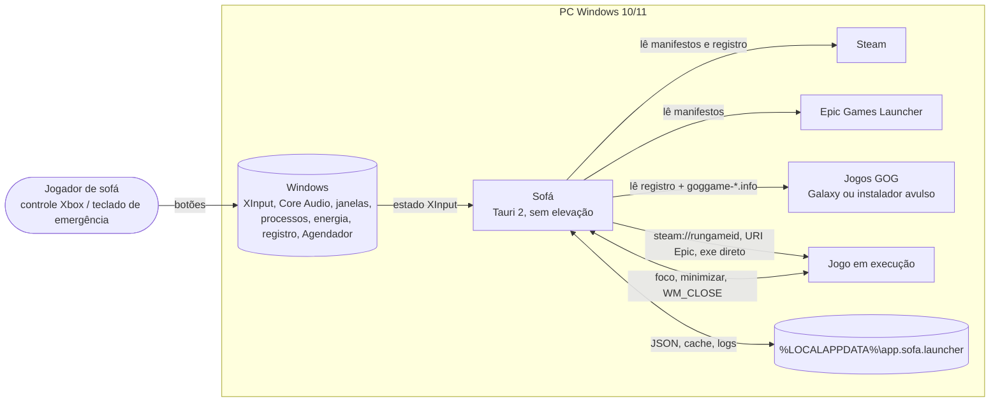
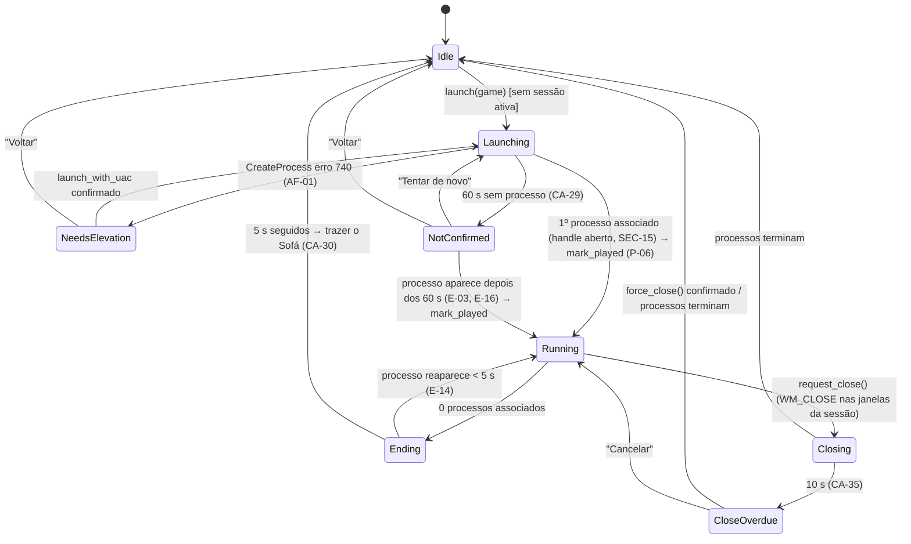
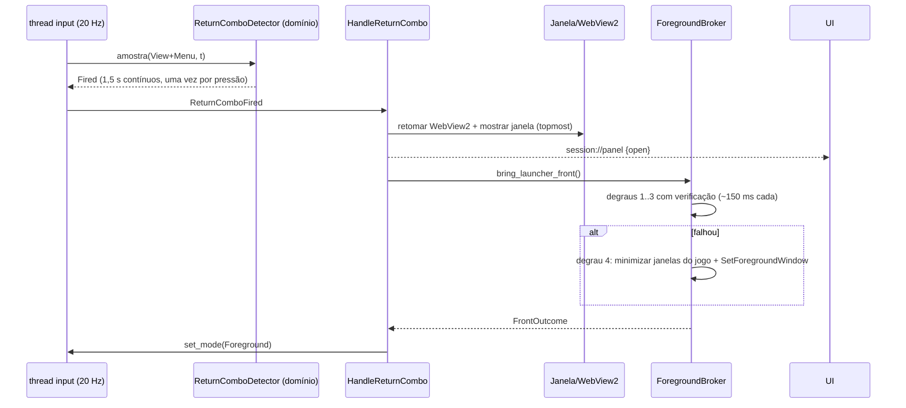

# Arquitetura: launcher-tv (Sofá)

| Campo | Valor |
|---|---|
| Feature | launcher-tv (MVP do launcher) |
| Produto | **Sofá** (nome exibido, com acento). Identificador técnico: `app.sofa.launcher`. Binário: `sofa.exe` |
| Spec | `docs/specs/launcher-tv.md` |
| Segurança | `docs/security/launcher-tv.md` (SEC-01 a SEC-30, AF-01 a AF-10 aprovados como recomendado) |
| Marca | `docs/brand/sofa/` (tokens, fontes woff2, ícones) |
| Branch | `feature/launcher-tv-20261113` (base `main`) |
| Repo | único: núcleo Rust (`src-tauri/` + `crates/`) e UI (`ui/`) |
| ADRs | 0001 a 0006 em `docs/adr/` |
| Data | 2026-11-14 (rev. 8: D-43, fallback do desinstalador restrito a dois arquivos e código de saída do purge, ADR-0006; SEC-BUG-01, membros do jogo no modo Job, ADR-0005; D-44, desligamento híbrido, desvio 5 revertido); 2026-11-14 (rev. 7: revisão de código ARQ-05 rodada 1, desvios 1 a 8 aceitos, seção 13); 2026-11-13 (rev. 6: cenário A da escada aprovado, P-08 b, P-09 a, SEC-19 aceito; rev. 5: resultado dos spikes técnicos SP-01, SP-02, SP-06, SP-07, SP-08 em `docs/arch/spikes/`; rev. 4: D-29 a D-35, sem spike com o usuário, Win10 como alvo principal; rev. 2: decisões do usuário P-01 a P-07 + SEC-xx; rev. 3: SEC-28 detalhado, SEC-31, SEC-32, DR-03, termos "Ocultar"/"Itens ocultos") |

Neste documento, "back" é o **núcleo** (Rust) e "front" é a **UI** (React no WebView2). O "contrato de API" é o conjunto de **comandos Tauri** (UI → núcleo) e **eventos** (núcleo → UI). Os termos de domínio seguem a seção 4 da spec. A seção 4 deste documento é a **baseline de comandos e capabilities** usada na verificação de SEC-03/SEC-05.

---

## 1. Visão

### 1.1 Contexto



Não há rede, servidor nem banco (RN-01, SEC-30). Todo dado sai de arquivos locais das lojas, do registro e dos JSON do próprio launcher.

### 1.2 Containers

```mermaid
flowchart TB
  subgraph Proc[Processo sofa.exe — usuário comum, asInvoker]
    subgraph Core[Núcleo Rust]
      pres[presentation<br/>comandos Tauri, eventos, protocolo cover://]
      app[application<br/>casos de uso + ports]
      dom[domain<br/>regras puras + políticas de caminho]
      infra[infrastructure-win<br/>adapters windows-rs]
      threads[[threads: input 120/20 Hz,<br/>system-events, audio (MTA COM), session-probe]]
    end
    subgraph WV[WebView2 — processos filhos]
      ui[UI React + TS<br/>navegação espacial, telas, stores, tokens da marca]
    end
  end
  ui -- invoke(comando por ID) --> pres
  pres -- emit(evento) --> ui
  pres --> app --> dom
  infra -. implementa ports .-> app
  threads --> infra
```

---

## 2. Núcleo (back-end)

### 2.1 Módulos e seams

Cada módulo é **deep**: interface pequena e muito comportamento dentro. Os seams com dois adapters reais (ou adapter real + fake de teste) estão marcados.

| Módulo | Interface (resumo) | O que esconde | Seam / adapters |
|---|---|---|---|
| **Input** | `subscribe() -> Receiver<InputEvent>`; `set_mode(Foreground \| Background \| Off)` | XInput nos 4 slots (slot vazio consultado a cada 1 s), zona morta 25% (RN-06), repetição (400 ms, depois a cada 100 ms; ARQ-05, desvio 4 aceito), borda do gatilho no meio do curso (RN-23), combinação de retorno de 1,5 s (RN-11), conexão e desconexão (CA-13 a CA-15), vários controles como um só (RN-08). Sem hook global (SEC-28) | `GamepadSource` (XInput; fake roteirizado) |
| **Library** | `snapshot()`, `refresh()`, `add_manual(path)`, `rename(id, name)`, `restore_name(id)`, `hide(id)`, `unhide(id)`, `hidden()`, `mark_played(id, at)` | Varredura das origens em paralelo, isolamento de falha e `panic` por origem (SEC-13), validação de IDs e caminhos (SEC-11, SEC-12, SEC-14, SEC-16), fusão com a camada do usuário (ADR-0004), unicidade (RN-03, E-12), ordenação (RN-05), normalização do nome exibido (SEC-07), filtro de itens que não são jogo na Steam (P-05) | `StoreScanner` ×3 (Steam, Epic, GOG) **seam real**; `LibraryRepository` (JSON; memória); `CoverCache` |
| **Session** | `launch(game_id)`, `launch_with_uac(game_id)`, `current()`, `return_to_game()`, `request_close()`, `force_close()`, `subscribe()` | Máquina de estados (2.4), prazo de 60 s (CA-29), tolerância de 5 s (E-14), varredura só de PID novo com cache, intervalo adaptativo (1 s em Launching/Ending, 2 s em Running) e espera nos handles dos membros para o fim imediato (ADR-0005), fechar em duas etapas (RN-12), troca de jogo (CA-31), conjunto de processos rastreado **por handle** com tempo de criação (SEC-15), lista de exclusão e direitos mínimos (SEC-17), erro 740 (AF-01) | `GameStarter` (exe+Job, URI de loja); `SessionProbe` (Job Object / varredura por pasta) **seam real**; `Clock` |
| **Foreground** (`ForegroundBroker`) | `bring_launcher_front() -> FrontOutcome { Front \| FrontAfterMinimize \| Failed }`; `give_front_to(session)`; `allow_others()` | Escada de tentativas com verificação (ADR-0003), ordem recomendada 1 → 3 → 2 → 4 (`AttachThreadInput` antes da tecla F24; minimizar por último), cada degrau ligável em runtime. Roda em **thread de trabalho**, com a janela do Sofá já visível e `TOPMOST` e a thread da janela sem bloqueio (SP-01). Usada na combinação de retorno **e** no fim de sessão (CA-30) | `WindowSystem` (Win32; fake para testar a escada) |
| **Audio** | `state() -> VolumeState { level, muted, available }`; `apply(VolumeCommand)`; `subscribe()` | COM em thread MTA, `IAudioEndpointVolume` do dispositivo padrão, `IAudioEndpointVolumeCallback` (CA-41), `IMMNotificationClient` (CA-42), regras de passo e mudo puras (CA-38 a CA-40, CA-64), limite 0 a 100 (SEC-27) | `AudioEndpoint` (Core Audio; fake) |
| **Power** | `capabilities()`; `prepare(PowerAction) -> PowerTicket`; `execute(PowerTicket)` | Ticket válido por 30 s e uso único (SEC-27). `AdjustTokenPrivileges(SeShutdownPrivilege)` só durante a chamada (AF-04); "Desligar" faz **o mesmo que o menu Iniciar** (D-44, rev. 8; o desvio 5 do ARQ-05 foi revertido): com a inicialização rápida ligada, `ExitWindowsEx(EWX_HYBRID_SHUTDOWN \| EWX_POWEROFF, SHTDN_REASON_FLAG_PLANNED)`; desligada, `EWX_POWEROFF`. "Ligada" = `HiberbootEnabled = 1` em `HKLM\SYSTEM\CurrentControlSet\Control\Session Manager\Power` **e** hibernação disponível (`GetPwrCapabilities`: `SystemS4` e `HiberFilePresent`), lido no `execute`, não em cache. Se `ExitWindowsEx` com o bit híbrido falhar, tenta uma vez `EWX_POWEROFF` e registra no log. "Reiniciar" é sempre **completo** (`EWX_REBOOT`, sem bit híbrido), como no menu Iniciar. Nunca `EWX_FORCE*` (RN-15, CA-49); ver RA-05; `SetSuspendState(FALSE, FALSE, FALSE)`; disponibilidade via `GetPwrCapabilities` (CA-47) | `PowerControl` (Win32; fake) |
| **Display** | `monitors()`; `place_launcher(preferred: Option<MonitorId>)`; `subscribe()` | ID estável (`monitorDevicePath` de `DisplayConfigGetDeviceInfo`), fallback para o principal (RN-20, CA-67), `WM_DISPLAYCHANGE`, tela cheia sem borda | `DisplayTopology` (Win32; fake) |
| **Autostart** | `is_enabled()`, `set(bool)`, `apply_install_default_once()` | **Tarefa agendada de logon do próprio usuário, `LeastPrivilege`** (P-03 b), com **fallback automático** para `HKCU\...\Run` (P-03 a) se `RegisterTaskDefinition` devolver erro (ex.: `E_ACCESSDENIED`) ou se a tarefa registrar falha real na última execução (`0x41303` = ainda não rodou, não é falha). A conferência de que a tarefa é do Sofá compara SID, `RunLevel = LUA` e caminho sem aspas (ADR-0006, SP-07). Caminho entre aspas + `--autostart` (SEC-22). Recusa registrar se o exe em execução não estiver sob `%ProgramFiles%` (DR-04). Um mecanismo ativo por vez: ligar um remove o outro. Depois do fallback, a volta Run → tarefa só acontece quando o usuário religa a opção; a nova tentativa "numa atualização do app" que SEC-22 (d) permite **não** é feita no MVP (ARQ-05, desvio 6: é o lado mais restritivo do requisito) | `AutostartRegistry` (TaskScheduler COM; HKCU Run) **seam real** |
| **SingleInstance** | (sem interface pública: só traz a janela) | Mutex do plugin `"{identifier}-sim"` no namespace da sessão (sem SID, aceito pela segurança: SEC-19 emendado com a condição de ignorar `argv`); o callback ignora `argv` e cwd por completo; `--autostart` só é lido pela própria instância que inicia (SEC-19) | `tauri-plugin-single-instance` (decidido no SP-07, aceito pela segurança) |
| **SystemEvents** | `subscribe() -> SystemEvent { DisplayChanged, Resumed, Suspending, ForegroundChanged }` | Janela **de topo oculta** (`WS_POPUP` sem `WS_VISIBLE`, `WS_EX_TOOLWINDOW \| WS_EX_NOACTIVATE`, nunca mostrada, fora do Alt+Tab e da barra de tarefas), e não `HWND_MESSAGE`: janela só de mensagem não recebe broadcast, e `WM_DISPLAYCHANGE` e `WM_POWERBROADCAST` chegam por broadcast (ARQ-05, desvio 1 aceito). `SetWinEventHook(EVENT_SYSTEM_FOREGROUND, EVENT_SYSTEM_FOREGROUND, NULL, cb, 0, 0, WINEVENT_OUTOFCONTEXT \| WINEVENT_SKIPOWNPROCESS)` fica **desligado no MVP**, porque nenhum caso de uso consome `ForegroundChanged` (ARQ-BUG-05). Se voltar a ser usado: `SKIPOWNPROCESS` não avisa quando o próprio Sofá volta à frente. Confirmado dentro de SEC-28; `WINEVENT_INCONTEXT` é proibido | só adapter Win32 |
| **Modo de remoção de dados** (`sofa.exe --purge-user-data`) | Entrada de linha de comando, tratada no `main` **antes** de criar Tauri, WebView2 e instância única; aceita só se for o **único** argumento; códigos de saída 0 (ok), 1 (parcial), 2 (alvo inválido), 3 (rodando elevado), 4 (Sofá aberto, rev. 8) | Existe só para o desinstalador, que o inicia como o usuário interativo e lê o código de saída (ADR-0006 §6b rev. 6; SEC-31). Recusa rodar elevado. Recusa rodar com o Sofá aberto (mutex `app.sofa.launcher-sim` existe → código 4, sem apagar; SEC-BUG-03). Calcula o alvo sozinho (`FOLDERID_LocalAppData` + identifier fixo no build), sem receber caminho. Confere SEC-25 (um nível abaixo, não é reparse point, contém `library.json` ou `settings.json`). Apaga **por handle** com `FILE_FLAG_OPEN_REPARSE_POINT`: pontos de reanálise são apagados sem descer neles. **Não é comando IPC**, não está na capability e não é repassado por segunda instância (SEC-19) | só adapter (`launcher-win/src/purge.rs`); a política do alvo é pura em `domain/data_dir_policy` |
| **FolderBrowser** | `list(path: Option<PathBuf>) -> DirListing` | Só unidades `DRIVE_FIXED`/`DRIVE_REMOVABLE`; sem UNC, `\\?\`, `\\.\`; só pastas e `.exe`; nunca lê conteúdo (SEC-09, AF-02) | só adapter (`std::fs` + Win32) |
| **Settings** | `get()`, `set_monitor(Option<MonitorId>)`, `advanced() -> AdvancedSettings` (só leitura no núcleo) | `settings.json`, migração por `schemaVersion`, backup do arquivo inválido, `MonitorId` aceito só se estiver na lista enumerada; seção `advanced` (degraus da escada, tolerâncias de sessão, zona morta, nível de diagnóstico) com faixas validadas e editável só à mão (9.3). **Dono em memória (BE-45, ARQ-05)**: `SettingsService` em `launcher-core/src/application/settings_service.rs` guarda as configurações, altera uma cópia, grava por `SettingsRepository` e só então troca a memória; `advanced_raw` volta intacto ao arquivo. Implementa o port `SettingsStore`, consumido por `DisplayService` e `AutostartService`. O composition root (`src-tauri/src/bootstrap.rs`, `AppState.settings`) só faz a ligação; não há mais regra de configurações em `src-tauri` | `SettingsRepository` (JSON; memória); `SettingsStore` (port do `SettingsService`) |

`StoreScanner` é o seam de extensão (Xbox, EA e outras lojas ficam fora do MVP, mas entram aqui sem tocar nos casos de uso):

```text
trait StoreScanner {
    fn origin(&self) -> Origin;                              // Steam | Epic | Gog
    fn scan(&self) -> Result<Vec<DetectedGame>, ScanError>;  // ScanError::NotInstalled não vai para a UI
}
DetectedGame { origin_key, name, install_dir, launch: LaunchSpec, cover_source: Option<PathBuf>, icon_source: Option<PathBuf> }
LaunchSpec = SteamUri{ app_id: u32 } | EpicUri{ namespace, catalog_item_id, app_name } | Exe{ path, args: Vec<String>, working_dir }
```

`LaunchSpec` é sempre construído **pelo núcleo**, a partir da detecção atual ou do jogo manual revalidado. A UI nunca o envia (SEC-03).

### 2.2 Detectores e lançamento por origem (revisado com o SP-08; observação em loja real no QA-17, QF-04)

| Origem | Descoberta | Lista de jogos | ID e validação | Capa / ícone | Como iniciar |
|---|---|---|---|---|---|
| Steam | `HKCU\Software\Valve\Steam\SteamPath`, que vem com barras normais e unidade minúscula: **normalizar** para `C:\...` antes das políticas de caminho | `steamapps\libraryfolders.vdf` (formato atual com entradas `"0"`, `"1"`… e `"path"`; tolerar o antigo `BaseInstallFolder_N`) → `appmanifest_<appid>.acf` com **teste de bit** 4 em `StateFlags` (`6` = instalado com atualização pendente aparece; `1`, `2`, `1026` não) | `appid` `^[0-9]{1,10}$` e cabe em `u32`. `installdir` = um único componente (sem `\`, `/`, `..`, `:`); pasta = `<library>\steamapps\common\<installdir>` (SEC-12) | `appcache\librarycache\<appid>_library_600x900.jpg` (layout antigo) ou `librarycache\<appid>\<hash>\library_600x900.jpg` (layout novo: **enumerar as subpastas de 1 nível** sob `<appid>\`) | **Template fixo** `steam://rungameid/<appid>` via `ShellExecuteExW` (verbo padrão). Nunca `steam://run/<id>//<args>` (SEC-11). A Steam abre se estiver fechada (CA-26) |
| Epic | `<FOLDERID_ProgramData>\Epic\EpicGamesLauncher\Data\Manifests\*.item` (`SHGetKnownFolderPath`, não variável de ambiente) | um `.item` por jogo (JSON; **remover BOM UTF-8** antes do parse; **campos desconhecidos ignorados**, sem `deny_unknown_fields`, que vale só para os JSON do Sofá); ignora `bIsIncompleteInstall = true` e DLC (`AppName` ≠ `MainGameAppName`; `MainGameAppName` ausente = jogo) | `CatalogNamespace`, `CatalogItemId`, `AppName` obrigatórios, em `^[A-Za-z0-9_.-]{1,128}$` (vazio ou ausente = item ignorado). `InstallLocation` absoluto local; `LaunchExecutable` relativo e confinado à pasta após canonicalizar (SEC-12) | sem capa local → ícone do exe | Template fixo `com.epicgames.launcher://apps/<ns>%3A<itemId>%3A<appName>?action=launch&silent=true`, componentes com percent-encoding, via `ShellExecuteExW` (SEC-11). Com a loja deslogada, o cliente abre e pede login: CA-26/CA-29 conferidos no QA-17 |
| GOG | `HKLM\SOFTWARE\WOW6432Node\GOG.com\Games\<id>`: o instalador avulso cria; **não confirmado se o Galaxy 2.0 sempre cria** (E-17, QA-17). Se não criar, a alternativa é varrer as pastas de instalação conhecidas por `goggame-*.info` (decidir com o log do QA-17) | uma subchave por jogo (`gameID`, `gameName`, `exe`, `path`, `workingDir`, `launchParam`…) | `gameID` `^[0-9]{1,20}$`; `path` passa por SEC-16 | `goggame-<id>.ico` na pasta do jogo, senão ícone do exe. Sem leitura do SQLite do Galaxy (AF-06) | **Exe direto** (P-02 a): `playTask` primário de `goggame-<id>.info` (`isPrimary: true`, `category: "game"`, `type: "FileTask"`; `URLTask` nunca é executada; `.info` sem `playTask` = item ignorado) com `path`, `arguments`, `workingDir`, confinado à pasta do jogo, `.exe` fora de `%SystemRoot%` (SEC-12, SEC-14), via `CreateProcessW` sem shell, com argumentos como lista (SEC-10), dentro de Job Object. Sem `.info` válido → `exe`/`workingDir` do registro |
| Manual | `library.json` | `manualGames[]` | Caminho canônico, unidade local fixa ou removível, `.exe` com cabeçalho `MZ`+`PE`, sem ADS nem nome reservado (SEC-09); revalidado a cada carga (SEC-18) | ícone do exe | `CreateProcessW` com `lpApplicationName` absoluto, `bInheritHandles=FALSE`, sem argumentos (AF-03), dentro de Job Object |

Regras comuns a todas as origens:
- ID ou caminho fora do formato faz o jogo ser **ignorado** e registrado no log. Nada é "sanitizado" (SEC-11).
- A pasta de instalação passa pela política de SEC-16 (profundidade ≥ 2, fora de pastas de sistema, da loja e do próprio Sofá).
- Arquivos de terceiros têm limite de 4 MB, checado **antes** de ler (SP-08: um VDF de 10 MB leva 372 ms e muita memória). Nenhum `unwrap` em dado de terceiro (SEC-13).
- **Pré-checagem de profundidade 32 no VDF, obrigatória e antes do parse**: varredura que conta `{`/`}` fora de aspas (11 ms para 10 MB). O `keyvalues-parser` é recursivo: com 10.000 níveis o processo morre por `STATUS_STACK_OVERFLOW`, que `catch_unwind` **não captura**.
- O parser aceita qualquer conteúdo (`appid` com `//`, `?&`, espaço, Unicode; `installdir` com `..`, `/`, `:`, vazio, `.`). **Toda a validação é das políticas do domínio.** As fixtures do SP-08 ficam em `crates/launcher-win/tests/fixtures/`.
- **Filtro Steam (P-05 a)**: lista fixa de appids que não são jogo, em `domain/library/steam_non_games.rs` : `228980` (Steamworks Common Redistributables, confirmado), mais candidatos a conferir no QA-17: `250820` (SteamVR), `1070560`, `1391110`, `1628350` (Steam Linux Runtime), `1493710` (Proton Experimental), `2180100` (Proton Hotfix). O resto o usuário oculta (CA-21).

### 2.3 Camadas e workspace Rust (Clean Architecture)

O repo está vazio, então a estrutura nasce com as camadas, e a regra de dependência é **garantida pelo compilador** (INV-01):

```text
gamelaucher/
├─ Cargo.toml                      # workspace
├─ rust-toolchain.toml             # stable fixado, >= 1.77.2 (SEC-24)
├─ crates/
│  ├─ launcher-core/               # SEM tauri, SEM windows-rs, SEM I/O
│  │  └─ src/
│  │     ├─ domain/
│  │     │  ├─ library/   (Game, GameId, Origin, merge, ordering RN-05, unicidade RN-03, nome exibido RN-22,
│  │     │  │              normalize_display_name SEC-07, id_formats SEC-11, install_path_policy SEC-12/14/16,
│  │     │  │              manual_exe_policy SEC-09 (regras sobre caminho já canônico), steam_non_games P-05)
│  │     │  ├─ session/   (SessionState, transições, prazos CA-29/E-14/RN-12, exclusões SEC-17)
│  │     │  ├─ input/     (deadzone, repeat, trigger edge, ReturnComboDetector, gating CA-12)
│  │     │  ├─ volume/    (apply(VolumeState, VolumeCommand))
│  │     │  ├─ display/   (choose_monitor RN-20)
│  │     │  └─ power/     (PowerAction, PowerTicket 30 s SEC-27)
│  │     └─ application/
│  │        ├─ ports.rs   (StoreScanner, LibraryRepository, SettingsRepository, CoverCache, GameStarter, SessionProbe,
│  │        │              WindowSystem, AudioEndpoint, PowerControl, DisplayTopology, AutostartRegistry, Clock)
│  │        └─ use_cases/ (um por ação; ver 2a)
│  └─ launcher-win/                # infraestrutura: launcher-core + windows-rs
│     └─ src/ (xinput.rs, audio.rs, power.rs, foreground.rs, process_probe.rs, job.rs, display.rs,
│              system_events.rs, cover_cache.rs, folder_browser.rs, path_canon.rs,
│              autostart/{task_scheduler.rs, run_key.rs}, stores/{steam,epic,gog}.rs, persistence/json.rs)
└─ src-tauri/                      # apresentação + composition root
   ├─ tauri.conf.json, capabilities/main.json, build.rs (AppManifest com a lista de comandos)
   ├─ sofa.exe.manifest            # asInvoker, uiAccess=false (SEC-20)
   └─ src/ (main.rs: SetDefaultDllDirectories primeiro (SEC-23), depois desvio para --purge-user-data, depois Tauri; lib.rs = composition root;
            commands/*.rs; events.rs; dto.rs; errors.rs; cover_protocol.rs; webview_hardening.rs)
```

- **Formato dos arquivos do Sofá (emenda ARQ-05)**: os codecs de `library.json`, `settings.json` e `cache\scan.json` (schema fechado, limites, `schemaVersion` e migração) são funções puras de bytes para tipo e ficam em `launcher-core` (`domain/library/stored.rs`, `domain/library/scan_cache.rs`, `domain/settings/`), com `serde`/`serde_json`. Assim são testados sem disco. O adapter `persistence/json.rs` só faz I/O atômico, backup e caminho. Limite da emenda: `serde` em `launcher-core` só nesses codecs. Entidades de domínio não derivam `Serialize` para a IPC; os DTOs ficam em `src-tauri/src/dto.rs`.
- **Domínio**: tipos e funções puras. Tempo entra como parâmetro (`now: Instant`). As políticas de segurança sobre caminhos e IDs são regras puras aqui, testadas por tabela. A canonicalização (que precisa do disco) fica em `launcher-win/path_canon.rs`.
- **Aplicação**: um caso de uso por ação da spec. Recebe ports por injeção e não conhece Win32 nem Tauri.
- **Infraestrutura**: adapters finos. Nenhuma RN-xx aqui.
- **Apresentação**: cada comando tem até ~10 linhas: desserializa em tipo fechado (`deny_unknown_fields`, enums, IDs com formato), chama o caso de uso e mapeia `AppError` → `ErrorDto` num único lugar (`errors.rs`, SEC-06).

### 2.4 Máquina de estados da sessão (domínio)



- **Último jogado = início da sessão (P-06 a)**: `lastPlayedAt` é gravado na transição para `Running`.
- **`NotConfirmed` (CA-29, rev. 7)**: ao entrar, o Sofá volta ao primeiro plano pela mesma escada do fim de sessão (a tela da loja pode estar na frente: login, atualização), e a entrada volta a `Foreground`. A sonda continua ligada: se o jogo abrir depois dos 60 s, a sessão vai a `Running` e segue o fluxo normal (janela oculta, WebView2 suspenso, `give_front_to`). "Voltar" encerra a sonda; um jogo que abra depois disso não vira sessão (como E-07). Desvio 3 aceito no ARQ-05; a volta ao primeiro plano é o ARQ-BUG-01.
- **Efeitos fora do `Mutex` (rev. 7)**: gravar `lastPlayedAt`, esconder ou mostrar a janela e a escada rodam **depois** de soltar o `Mutex` da sessão (ARQ-BUG-02). A thread da UI (callback da instância única, eventos de janela) pode pegar esse `Mutex`, então nada que espera a thread da UI pode rodar com ele preso.
- **Encerramento (SEC-15, SEC-17)**: cada processo entra no conjunto da sessão com handle `PROCESS_QUERY_LIMITED_INFORMATION | SYNCHRONIZE` aberto na detecção e com o tempo de criação guardado. `force_close` duplica o handle guardado com `PROCESS_TERMINATE` e confere o tempo de criação antes de `TerminateProcess`. **No Job Object, igual (rev. 8, SEC-BUG-01)**: cada PID do Job passa pelo mesmo `classify` (pasta do exe ou do jogo GOG + exclusões abaixo); só os membros recebem `WM_CLOSE` e `terminate_if_same`; os demais são acompanhantes (ex.: `steam.exe` ou navegador abertos pelo jogo) e não mantêm a sessão viva. A sessão vai a `Ending` quando não sobra membro. `TerminateJobObject` é proibido (ADR-0005 rev. 6). Nunca entram no conjunto: o Sofá e seus filhos WebView2 (o fecho de `msedgewebview2.exe` a partir do PID do Sofá, **não** todo filho direto: o jogo manual ou GOG e a Steam aberta pelo Sofá são filhos diretos; desvio 2 conferido no ARQ-05), processos das lojas, `explorer.exe`, outra sessão ou usuário, processos protegidos.
- **Jogo elevado (AF-01)**: com `launch_with_uac` o processo não entra no Job (UIPI) e a sessão usa varredura por pasta. "Fechar" e "Voltar ao jogo" podem falhar e mostram mensagem, sem tentar elevar (SEC-17, RA-02).

### 2.5 Fluxos principais

**Iniciar jogo (CA-26, CA-27)**

```mermaid
sequenceDiagram
  participant UI
  participant Cmd as cmd session_launch
  participant UC as LaunchGame
  participant Lib as Library
  participant FG as ForegroundBroker
  participant St as GameStarter
  participant Pr as SessionProbe
  UI->>Cmd: session_launch(gameId)
  Cmd->>UC: execute(gameId) (serializado, SEC-06)
  UC->>Lib: resolve(gameId) → LaunchSpec revalidado (SEC-09/12/14; exe ausente → GameFileMissing, CA-28)
  UC-->>UI: session://state {Launching}
  UC->>FG: allow_others() (AllowSetForegroundWindow ASFW_ANY)
  UC->>St: start(LaunchSpec) (CreateProcessW+Job | ShellExecuteExW de URI com template fixo)
  St->>Pr: watch(job | install_dir [+ RunningAppID Steam])
  Pr-->>UC: ProcessSeen(handle, creation_time)
  UC->>Lib: mark_played(gameId, now) (P-06)
  UC-->>UI: session://state {Running}
  UC->>FG: give_front_to(session), esconder a janela e suspender o WebView2
```

**Combinação de retorno (CA-32, CA-63, M-04)**



**Fim de sessão pelo menu do jogo (CA-30)**: `SessionProbe` → `Ending` → 5 s → `Idle` → `bring_launcher_front()` (mesma escada) → `library://changed` com o jogo no topo e `focusGameId`.

**"Ir para a biblioteca" com jogo aberto (CA-36, P-04 a)**: o jogo **não** é minimizado. O Sofá vem para a frente e o jogo fica como está. Um jogo que leia XInput sem checar o foco também recebe os botões (RA-01). O QA lista os jogos afetados.

### 2.6 Threads, concorrência e erros

- **Threads dedicadas, sem runtime async no caminho quente**: `input`, `system-events`, `audio` (COM MTA) e `session-probe` (só durante a sessão). Os comandos Tauri conversam com elas por canais.
- **Estado do app** em `AppState` com `Mutex` curto por módulo. A biblioteca é um `Arc<LibrarySnapshot>` imutável, trocado inteiro a cada mudança.
- **Idempotência e serialização (SEC-06)**: `library_refresh` e `session_launch` aceitam uma execução por vez, e chamadas concorrentes recebem `Busy`. `launch` com sessão ativa → `SessionAlreadyActive` (CA-31). `force_close` só em `CloseOverdue`. `power_execute` só com ticket válido e não usado.
- **Erros**: `AppError` → `ErrorDto { code, params }`. A UI traduz `code` para texto pt-BR. Falha de loja vira log e não chega à UI (CA-18, CA-59). `catch_unwind` no limite de cada comando e de cada `StoreScanner`.
- **Escrita em disco**: atômica (temporário na mesma pasta + `ReplaceFileW`/`MoveFileExW(MOVEFILE_REPLACE_EXISTING | MOVEFILE_WRITE_THROUGH)`), por um único dono, e só dentro da pasta de dados (SEC-18, SEC-29).

---

## 2a. Camadas: mapa feature → pasta

| Parte da feature | Domínio | Aplicação (casos de uso) | Infraestrutura | Apresentação |
|---|---|---|---|---|
| Biblioteca e detectores | `domain/library` | `refresh_library`, `add_manual_game`, `rename_game`, `restore_name`, `hide_game`, `unhide_game` | `stores/*`, `persistence/json.rs`, `cover_cache.rs`, `path_canon.rs`, `folder_browser.rs` | `commands/library.rs`, `cover_protocol.rs` |
| Sessão e retorno | `domain/session`, `domain/input` | `launch_game`, `launch_game_with_uac`, `replace_game`, `return_to_game`, `close_game`, `force_close_game`, `handle_return_combo` | `job.rs`, `process_probe.rs`, `foreground.rs`, `xinput.rs` | `commands/session.rs`, `events.rs` |
| Volume | `domain/volume` | `step_volume`, `toggle_mute` | `audio.rs` | `commands/volume.rs` |
| Energia | `domain/power` | `prepare_power_action`, `execute_power_action` | `power.rs` | `commands/power.rs` |
| Monitor | `domain/display` | `set_launcher_monitor` | `display.rs`, `system_events.rs` | `commands/settings.rs` |
| Autostart | — | `set_autostart`, `apply_install_default_once` | `autostart/*` | `commands/settings.rs` |

UI (`ui/src`):

| Camada | Pasta | Conteúdo |
|---|---|---|
| UI | `features/*/components`, `shared/ui` | Componentes de apresentação. Não chamam `invoke` e só renderizam texto (SEC-07) |
| Estado/fluxo | `features/*/store.ts`, `app/navigation` | Stores Zustand por feature, pilha de telas, tabela intenção → ação por tela |
| Serviços/dados | `shared/ipc` | Wrappers tipados gerados (`tauri-specta`). **Único** lugar que importa `@tauri-apps/api` |
| Domínio do front | `shared/domain`, `shared/input` | Tipos, teclado → intenção, textos de erro por `code`, truncamento (E-13) |
| Tema | `shared/theme` | Ponte para os tokens da marca (3.5) |

---

## 2b. Inventário de reuso

O repo não tem código para reaproveitar, então o reuso é de bibliotecas e dos assets de marca já entregues. Todas as libs têm licença permissiva e passam por `cargo deny` e pelo audit do gerenciador JS antes de cada release (SEC-24).

### Núcleo (Rust)

| Necessidade | Reusar | Licença | Em vez de |
|---|---|---|---|
| Shell do app, IPC, janela, bundler NSIS | `tauri` 2.x, `tauri-build` | MIT/Apache-2.0 | host WebView2 próprio |
| Win32/COM (XInput, Core Audio, janelas, processos, Job, energia, DisplayConfig, ícones, **Agendador de Tarefas `ITaskService`**) | `windows` (windows-rs) | MIT/Apache-2.0 | `winapi`, FFI manual, `schtasks.exe` via shell |
| Registro | `windows-registry` | MIT/Apache-2.0 | `winreg` |
| Instância única | `tauri-plugin-single-instance` (o dev confere no código do plugin se o nome do mutex inclui o SID, SEC-19; se não incluir, adapter próprio de ~60 linhas) | MIT/Apache-2.0 | — |
| Autostart | **adapter próprio** (`AutostartRegistry`: tarefa agendada via `ITaskService` + `HKCU Run` via `windows-registry`) | — | `tauri-plugin-autostart` (só cobre `Run` e não cobre a tarefa da P-03) |
| VDF da Steam | `keyvalues-parser` (com pré-checagem de tamanho e profundidade, SEC-13) | MIT | parser próprio |
| JSON | `serde`, `serde_json` (`deny_unknown_fields`) | MIT/Apache-2.0 | — |
| Tipos TS dos comandos e eventos | `tauri-specta` + `specta` (fallback `ts-rs`) | MIT | tipos duplicados |
| Ordenação sem acento | `unicode-normalization` | MIT/Apache-2.0 | ICU |
| Decodificar e reencodar capas e ícones (SEC-08) | `image` com `default-features = false`, features `jpeg`, `png` | MIT/Apache-2.0 | servir a imagem crua da loja ao WebView |
| Logs | `tracing`, `tracing-subscriber`, `tracing-appender` | MIT | — |
| Erros | `thiserror` | MIT/Apache-2.0 | — |
| Gamepad / processos | XInput e ToolHelp via `windows` (ADR-0002, ADR-0005) | — | `gilrs`, `sysinfo` |

**Como ficou no código (ARQ-05, rodada 1).** Diferenças em relação à tabela acima, todas aceitas:
- `ts-rs` no lugar de `tauri-specta` (fallback já previsto, RA-06). Tipos em `ui/src/shared/ipc/generated/`.
- Registro pela feature `Win32_System_Registry` do próprio `windows`, sem `windows-registry`.
- Logs com `tracing` + `tracing-subscriber` e um escritor próprio com rotação por tamanho (`launcher-win/src/logging.rs`), porque `tracing-appender` só gira por tempo. `tracing-appender::non_blocking` continua candidato para tirar o I/O do caminho quente (ARQ-BUG-07).
- Novos e justificados: `sha2` (ID do jogo manual por SHA-256, CT-05); `webview2-com` + `windows-core` 0.62 (suspender e retomar o WebView2, SP-06); `embed-resource` (build, só manifesto dos binários de teste).
- Dois `windows-rs` no build (0.58 do workspace, 0.6x do Tauri): aceito até o alvo MSVC permitir subir o workspace (ADR-0001).

### UI

| Necessidade | Reusar | Licença |
|---|---|---|
| Framework + build | React + TypeScript + Vite | MIT |
| Navegação espacial | `@noriginmedia/norigin-spatial-navigation` | MIT |
| Estado | `zustand` | MIT |
| IPC | `@tauri-apps/api` (só em `shared/ipc`) | MIT/Apache-2.0 |
| Grade virtualizada | `@tanstack/react-virtual` | MIT |
| Testes / E2E | Vitest, Testing Library, `mockIPC`, `tauri-driver` + WebdriverIO | MIT |
| **Marca** | `docs/brand/sofa/tokens.css`, `tokens.json`, `assets/fonts/*.woff2` (OFL 1.1), `assets/*.svg`, `assets/icon.ico`, `assets/png/icon-512.png` | OFL / do projeto |

### Criado do zero (e por quê)

- **Modo `sofa.exe --purge-user-data`** (`launcher-win/src/purge.rs` + `domain/data_dir_policy`): SEC-31 exige que a remoção dos dados rode como o usuário, sem elevação, e por handle. Reaproveita o binário instalado em vez de criar um helper separado. Não usa crate novo: a remoção por handle é feita com `windows` (`CreateFileW` com `FILE_FLAG_OPEN_REPARSE_POINT`, `GetFileInformationByHandleEx`, `SetFileInformationByHandle(FileDispositionInfoEx)`).

- **Detectores Epic e GOG**: não há crate mantido. São leitores pequenos atrás de `StoreScanner`.
- **`ForegroundBroker`**: lógica específica do produto (ADR-0003).
- **Máquina de sessão, combinação de retorno, repetição de direção e políticas de caminho e ID**: regras de negócio e de segurança da spec, puras, no domínio.
- **`AutostartRegistry`**: a P-03 exige a tarefa agendada, que nenhum plugin cobre.
- **Protocolo `cover://` + `CoverCache`**: SEC-08.

---

## 3. UI (front-end)

### 3.1 Navegação

A navegação não usa router de URL. Uma **pilha de telas** fica numa store (`app/navigation`): `B` desempilha (CA-10) e a tela inicial ignora `B`. Overlays são camadas com árvore de foco própria. Não existe link externo (SEC-02).

| Tela | Conteúdo | Carga |
|---|---|---|
| `Home` (biblioteca) | Recentes + grade, card em foco ampliado, "Em andamento" (CA-36), faixa "Nenhum controle" (CA-13), estado vazio (CA-23) | eager |
| `AllGames` | Grade alfabética, virtualizada | eager |
| `GameOptions` (overlay) | Renomear (CA-61), Restaurar nome (CA-62), **Ocultar** (CA-21; nunca apaga arquivos, RN-04) | eager |
| `RenameDialog` | Campo de texto (teclado físico), Enter/Esc | lazy |
| `QuickMenu` (overlay) | Volume (←/→), Mudo, Desligar, Reiniciar, Suspender, Configurações, Sair | eager |
| `ConfirmDialog` | Genérico, "Cancelar" em foco (RN-14), aviso de sessão (CA-48) | eager |
| `SessionPanel` | Voltar ao jogo / Fechar jogo / Ir para a biblioteca / menu rápido | eager |
| `LaunchingOverlay` | "Abrindo <nome>…", falha (CA-28 com "Ocultar" / "Voltar", CA-29), pede administrador (AF-01), fechando/forçar (CA-35) | eager |
| `Settings` (Tela, Biblioteca, Geral, **Itens ocultos**) | Monitor, autostart, atualizar biblioteca; **Itens ocultos** lista os itens e A + confirmar restaura (CA-70; vazio = "Nenhum item oculto") | **lazy** |
| `FolderBrowser` | Unidades locais → pastas → `.exe` | **lazy** |

### 3.2 Árvore de componentes (telas principais)

```text
App
├─ InputBridge                 (input://intent + keydown → intenção → camada de foco do topo)
├─ CursorAutoHide              (CA-03)
├─ SafeArea                    (CA-54: --safe-x/--safe-y da marca)
│  └─ ScreenStack
│     ├─ HomeScreen
│     │  ├─ ControllerBanner
│     │  ├─ HeroGame
│     │  ├─ GameRow "Recentes"  └─ GameCard* (CoverImage | CoverPlaceholder | OriginBadge | InProgressBadge)
│     │  ├─ GameGrid (virtualizada) └─ GameCard*
│     │  └─ EmptyLibrary
│     ├─ SessionPanel └─ MenuList └─ MenuItem*
│     └─ (lazy) SettingsScreen / FolderBrowserScreen
├─ OverlayLayer: QuickMenu | GameOptions | ConfirmDialog | RenameDialog | LaunchingOverlay
└─ VolumeHud                   (CA-64)
```

### 3.3 Mapeamento de botões

- O núcleo emite `InputIntent`: `Up | Down | Left | Right | Confirm | Back | Menu | View | PagePrev | PageNext | VolumeDown | VolumeUp`, com `repeat`. O teclado de emergência é traduzido em `shared/input/keyboard.ts` para as **mesmas** intenções. Os atalhos do navegador ficam desligados no WebView2 (SEC-02), então F5, F12 e Ctrl+P não fazem nada.
- Direções vão para o `norigin-spatial-navigation`. As demais intenções vão para a camada de foco do topo:
  - Home: `Confirm` inicia, `View` abre opções, `Menu` abre o menu rápido, `PagePrev/Next` pula linha, `VolumeUp/Down` → `volume_step` (RN-23), `Back` não faz nada.
  - Menus, diálogos e painel: volume pelos gatilhos é ignorado (CA-65); no menu rápido o volume usa `Left/Right`.
- As regras de negócio ficam no núcleo; a UI só exibe o resultado.

### 3.4 Estado e dados

- **Estado do núcleo**: um `invoke` de carga por domínio e depois só eventos com estado completo. Sem polling e sem fetch duplicado.
- **Estado local**: pilha de telas, foco, overlays, texto do renomear.
- **Desempenho**: capas `loading="lazy"`, `decoding="async"` e dimensões fixas; animação só em `transform`/`opacity`; grade virtualizada acima de ~60 itens; `Settings` e `FolderBrowser` lazy; animações pausadas com a janela oculta.
- **Texto (SEC-07)**: todo dado externo é renderizado por JSX como texto. `dangerouslySetInnerHTML` e `innerHTML` são proibidos por regra de ESLint (`react/no-danger` + `no-restricted-properties`).

### 3.5 Marca (Sofá): onde a UI consome

Fonte única: `docs/brand/sofa/`. A UI **importa daqui sem copiar**, para não haver duas versões dos tokens:

| Asset | Consumido em | Como |
|---|---|---|
| `tokens.css` (cores, escala `--u = 100vh/1080`, tipografia, espaçamento, raios, `--focus-ring`, `--glow-spotlight`, `@font-face`) | `ui/src/main.tsx` importa `@brand/tokens.css` | Alias Vite `@brand` → `../docs/brand/sofa` e `server.fs.allow` incluindo a pasta. O Vite resolve os `url("./assets/fonts/*.woff2")` relativos ao CSS e empacota as fontes com hash. Nada de Google Fonts (CSP `font-src 'self'`) |
| `tokens.json` (durações 160/200 ms, easing, contraste) | `ui/src/shared/theme/tokens.ts` | `import tokens from '@brand/tokens.json'`, para os valores de movimento usados em JS (ex.: repetição visual do foco, duração do `VolumeHud`) |
| `assets/fonts/*.woff2` (Sora, Figtree) | via `@font-face` do `tokens.css` | Licenças OFL (`OFL-*.txt`) copiadas para o bundle e listadas na tela "Sobre" ou no instalador |
| `assets/logo-horizontal.svg`, `wordmark.svg`, `symbol.svg` | `shared/ui/Brand*.tsx` (cabeçalho do menu rápido, estado vazio) | `import` de SVG como URL (asset local, `img-src 'self'`) |
| `assets/splash.svg` | `app/BootSplash.tsx` | Primeiro paint enquanto a biblioteca carrega do cache (M-02) |
| `assets/png/icon-512.png` | `src-tauri/icons/` | Gerado uma vez com `npx tauri icon docs/brand/sofa/assets/png/icon-512.png`; ícones gerados ficam versionados |
| `assets/icon.ico` | `tauri.conf.json` → `bundle.windows.nsis.installerIcon` e ícone da janela | Já traz 16 a 256 px |

Regras da marca que viram componentes: anel de foco duplo + halo em `shared/ui/Focusable` (um item em foco, CA-55); `CoverPlaceholder` com gradiente e nome em Sora 700 (CA-24); `prefers-reduced-motion` remove escala e brilho; diálogos destrutivos com "Cancelar" em foco.

---

## 4. Contrato: comandos, eventos, capabilities e CSP (baseline SEC-03 / SEC-05)

O contrato final, com DTOs e códigos de erro completos, é do `dev-backend` em `docs/api/`. **Esta lista é fechada**: qualquer comando novo exige atualizar este documento e passar pela revisão de segurança. Nenhum comando recebe caminho de executável, argumentos, URI, PID, chave de registro ou comando de shell. As exceções com caminho são `fs_list_dir` e `library_add_manual`, ambas sob SEC-09.

### 4.1 Comandos (UI → núcleo)

| # | Comando | Entrada (tipo fechado) | Saída | Erros principais |
|---|---|---|---|---|
| 1 | `library_get` | — | `LibrarySnapshot { games: GameDto[], focusGameId? }` | — |
| 2 | `library_refresh` | — | `()` → `library://changed` | `Busy` |
| 3 | `library_add_manual` | `path: String` (≤ 1024, SEC-09) | `GameDto` | `Duplicate` (CA-20), `NotAnExecutable`, `PathNotAllowed`, `NotFound` |
| 4 | `library_hidden` | — | `GameDto[]` | — |
| 5 | `game_rename` | `gameId: GameId`, `name: String` (1..256 após normalizar, SEC-07) | `GameDto` | `EmptyName`, `UnknownGame` |
| 6 | `game_restore_name` | `gameId` | `GameDto` | `UnknownGame` |
| 7 | `game_hide` | `gameId` | `()` | `UnknownGame` |
| 8 | `game_unhide` | `gameId` | `()` | `UnknownGame` |
| 9 | `fs_list_dir` | `path: Option<String>` (vazio = unidades locais) | `DirListing { path, parent?, entries: [{ name, kind: Drive\|Dir\|Exe }] }` | `PathNotAllowed`, `AccessDenied`, `NotFound` |
| 10 | `session_get` | — | `SessionDto { state, gameId?, since? }` | — |
| 11 | `session_launch` | `gameId` | `()` | `SessionAlreadyActive{gameId}`, `GameFileMissing{path}`, `StoreNotInstalled`, `NeedsElevation`, `Busy` |
| 12 | `session_launch_with_uac` | `gameId` (só aceito em `NeedsElevation` para o mesmo jogo, AF-01) | `()` | `InvalidState` |
| 13 | `session_replace` | `gameId` (fecha o atual após CA-31 e abre o novo) | `()` | idem 11 |
| 14 | `session_return_to_game` | — | `()` | `NoActiveSession`, `ForegroundDenied` |
| 15 | `session_close` | — | `()` | `NoActiveSession` |
| 16 | `session_force_close` | — | `()` | `NotOverdue`, `AccessDenied` (jogo elevado) |
| 17 | `session_retry` | — | `()` | `InvalidState` |
| 18 | `session_dismiss` | — | `()` | — |
| 19 | `volume_get` | — | `VolumeState { level, muted, available }` | — |
| 20 | `volume_step` | `direction: Up\|Down` | `VolumeState` | `NoAudioDevice` |
| 21 | `volume_toggle_mute` | — | `VolumeState` | `NoAudioDevice` |
| 22 | `power_capabilities` | — | `{ shutdown, restart, suspend: Available\|Unavailable }` | — |
| 23 | `power_prepare` | `action: Shutdown\|Restart\|Suspend` | `PowerTicket` (opaco, 30 s, uso único) | `Unavailable` |
| 24 | `power_execute` | `ticket: PowerTicket` | `()` | `TicketInvalid`, `Rejected` |
| 25 | `settings_get` | — | `SettingsDto { autostart, autostartMechanism, monitorId?, logDir }` | — |
| 26 | `settings_set_autostart` | `enabled: bool` | `SettingsDto` | `AutostartFailed` |
| 27 | `settings_set_monitor` | `monitorId: Option<MonitorId>` (deve estar em `display_monitors`) | `SettingsDto` | `UnknownMonitor` |
| 28 | `display_monitors` | — | `MonitorDto[] { id, name, primary, current }` | — |
| 29 | `input_status` | — | `{ connected: u8 }` | — |
| 30 | `app_exit` | — | `()` (CA-05; a sessão continua) | — |

`GameId` = `"<origin>:<key>"` com formato validado por origem (seção 5). `power_prepare` é chamado quando o diálogo de confirmação abre e `power_execute` quando o usuário confirma (RN-14 na UI, SEC-27 no núcleo).

### 4.2 Eventos (núcleo → UI)

| Evento | Payload | Quando |
|---|---|---|
| `input://intent` | `{ intent, repeat }` | Sofá em primeiro plano |
| `input://controllers` | `{ connected }` | Conexão ou desconexão (≤ 2 s) |
| `library://changed` | `LibrarySnapshot` | Varredura, renomear, ocultar, fim de sessão |
| `session://state` | `SessionDto` | Toda transição de 2.4 |
| `session://panel` | `{ open: true, outcome }` | Combinação de retorno |
| `volume://changed` | `VolumeState` | Mudança interna ou externa, troca de dispositivo |
| `display://changed` | `MonitorDto[]` | Plug ou unplug |
| `system://resumed` | — | Volta da suspensão |

### 4.3 Capabilities (`src-tauri/capabilities/main.json`)

- **Uma** capability, `windows: ["main"]`, sem `remote` (SEC-05). `app.withGlobalTauri = false`.
- Permissões: só `allow-<comando>` para os 30 comandos acima (gerados por `build.rs` com `AppManifest::commands`), mais `core:event:allow-listen` e `core:event:allow-unlisten`.
- **Não** incluir `core:default` nem `core:window:*` (janela, tela cheia, foco e minimizar são feitos pelo núcleo em Rust, sem expor nada à UI), nem plugins `shell`, `fs`, `http`, `opener`, `dialog`, `process`, `updater`, `sql` ou `autostart` (SEC-04).
- Verificação: teste de CI compara a lista do `generate_handler!` e de `main.json` com a tabela 4.1.

### 4.4 CSP e endurecimento do WebView (SEC-01, SEC-02)

```text
default-src 'self'; script-src 'self'; style-src 'self'; img-src 'self' cover: http://cover.localhost data:;
font-src 'self'; connect-src ipc: http://ipc.localhost; object-src 'none'; frame-src 'none';
base-uri 'none'; form-action 'none'
```

- No Windows, protocolos customizados do Tauri são servidos como `http://<scheme>.localhost`, por isso `http://cover.localhost` aparece em `img-src`. `data:` só em `img-src`, para ícones SVG pequenos inline gerados no build. Sem `unsafe-inline`/`unsafe-eval`: React aplica `style` via CSSOM, que a CSP permite. `dangerousDisableAssetCspModification` não é usado.
- `webview_hardening.rs` (via `with_webview`): `AreDevToolsEnabled=false` no release, `AreBrowserAcceleratorKeysEnabled=false`, `AreDefaultContextMenusEnabled=false`, `IsStatusBarEnabled=false`. O handler `on_navigation` recusa qualquer URL fora da origem do app e `NewWindowRequested` é cancelado. Sem a feature `devtools` no release.

### 4.5 Protocolo `cover://` (SEC-08)

`GameDto.cover = "cover://<gameId>"`. O handler aceita só `GameId` existente na biblioteca. Qualquer outra coisa (`..`, id inexistente) → 404 e a UI mostra o placeholder. O `CoverCache` lê a imagem da loja ou o ícone do exe no núcleo e checa o tamanho do arquivo (≤ 20 MB) e as dimensões no cabeçalho (≤ 8192×8192) antes de decodificar. Depois reencoda numa pasta própria (`cache\covers\`, chave = hash do caminho de origem + tamanho + mtime): capas em JPEG q85 com no máximo 600×900, ícones em PNG 256×256. O WebView nunca decodifica bytes de terceiros. Não há `assetProtocol` habilitado.

---

## 5. Entidades e ownership dos dados

Não há banco. Formato e local: ADR-0004. **Pasta de dados: `%LOCALAPPDATA%\app.sofa.launcher\`** (SEC-18, SEC-25), igual a `app_local_data_dir()` do Tauri.

| Entidade | Dono | Persistida? | Onde (relativo à pasta de dados) |
|---|---|---|---|
| Jogo detectado | A loja | Não (cache descartável) | `cache\scan.json` |
| Jogo manual | Usuário | Sim (revalidado na carga, SEC-18) | `library.json → manualGames[]` |
| Camada do usuário por jogo (nome personalizado, oculto, último jogado = início da sessão) | Usuário | Sim | `library.json → overlay{GameId}` |
| Configurações (monitor), marcador `installDefaultsApplied` | Usuário | Sim | `settings.json` |
| Iniciar com o Windows | Windows | Fonte única: a tarefa agendada do usuário **ou** a entrada `HKCU\...\Run` (sem cópia no JSON) | Agendador / registro |
| Padrão de autostart do instalador | Instalador | Sim | `HKLM\Software\app.sofa.launcher\InstallDefaults` (escrito só pelo instalador elevado; o app só lê) |
| Sessão de jogo | Núcleo | Não (memória) | — |
| Capas e ícones reencodados | Núcleo | Cache | `cache\covers\`, `cache\icons\` |
| Dados do WebView2 | WebView2 | Cache | `EBWebView\` |
| Logs | Núcleo | 5 MB × 3 arquivos (SEC-18) | `logs\` |

Formatos de `GameId`: `steam:<u32>`, `epic:<AppName>` (`^[A-Za-z0-9_.-]{1,128}$`), `gog:<^[0-9]{1,20}$>`, `manual:<hash do caminho canônico>`. No jogo manual, o caminho em si fica no registro do jogo e não no ID, para que o ID não carregue caminho pela IPC. Limites de leitura: arquivo de dados ≤ 4 MB, ≤ 5.000 jogos manuais, strings ≤ 1.024.

---

## 6. Requisitos não funcionais

| Tema | Meta | Como |
|---|---|---|
| Latência de input (M-05) | ≤ 50 ms botão → foco desenhado | leitura a ~120 Hz + emit + render + frame |
| Retorno (M-04) | ≤ 3 s; meta interna ≤ 1 s | Medido: escada ≤ 350 ms no pior caso (SP-01: degrau 1 falha em 150 a 200 ms, degrau 3 em 5 a 30 ms ou 2 em 1 a 5 ms); retomada do WebView2 ~30 ms (SP-06); input a 20 Hz. Com jogo real e Sofá real: QA-17 |
| Boot (M-02) | ≤ 5 s até navegável | tarefa de logon sem o atraso do Explorer (P-03 b), splash da marca no primeiro paint, biblioteca do cache, varredura depois |
| Volume na tela | ≤ 200 ms | thread de áudio, resposta síncrona + evento |
| Varredura | < 500 ms para 300 jogos em SSD | paralela por origem; capas reencodadas sob demanda e guardadas em cache (o 1º reencode de 300 capas roda em segundo plano, fora do caminho do boot) |
| CPU em segundo plano (RN-21) | **< 1% da CPU total** (base do Gerenciador de Tarefas); meta interna < 0,3% do total | Medido (16 lógicos): WebView2 suspenso 0,00 a 0,013% do total (0 a 0,21% de 1 núcleo); input 20 Hz com 1 controle ~0,1% de 1 núcleo (slot vazio só a cada 1 s); probe de loja com cache por PID + 2 s em Running ~0,02 a 0,04% do total (meta própria < 0,1% do total); Job Object zero. Ordem: `hide` → `IsVisible(false)` → `MemoryUsageTargetLevel(LOW)` → `TrySuspend`; volta: `Resume` → `IsVisible(true)` → `show`. **Não esvaziar o DOM** (a retomada iria de 30 para ~555 ms). Na sala: QF-07 |
| Memória (**working set privado**, a coluna "Memória" do Gerenciador de Tarefas, somando `sofa.exe` e os processos do WebView2) | < 250 MB na frente; < 120 MB suspenso | SP-06: suspenso **118 MB** (cumprida, no limite); oculto sem suspender 127 MB; na frente **293 MB no pior caso** (300 capas montadas, sem virtualização). Piso do WebView2 ~70 a 120 MB, independente do conteúdo. A meta na frente é **remedida com a UI real** (grade virtualizada, ≤ ~60 capas montadas, 3.4) no BE-20/FE; se ainda estourar, reduzir as capas montadas ou o tamanho do cache de imagem. Na sala: QF-07 |
| Biblioteca grande | 500 jogos fluidos | grade virtualizada, capas de no máximo 600×900 |
| Robustez | falha de loja, imagem ou JSON não derruba | SEC-13, `catch_unwind`, backup do JSON inválido |
| Observabilidade | log local INFO | `tracing`: contagem e duração por origem, jogos rejeitados por validação (motivo, sem caminho em INFO), transições de sessão, degrau da escada e tempo, ações de energia, erros. Sem telemetria |
| Escala/DPI | 1080p a 4K, 100% a 300% | tokens da marca em `--u` (`100vh/1080`) |

---

## 7. Invariantes tocados

Estes passam a valer para o repo e devem ir para um futuro `docs/arch/principios.md`.

| ID | Invariante | Como esta feature respeita | Guard mecânico |
|---|---|---|---|
| INV-01 | Domínio e aplicação não dependem de Tauri, do Windows nem de I/O | `crates/launcher-core` sem essas dependências | CI: `cargo tree -p launcher-core` sem `windows`/`tauri` |
| INV-02 | A UI só fala com o sistema por comandos de domínio por ID | Lista fechada (4.1), capability mínima (4.3) | CI compara `generate_handler!`/`main.json` com 4.1 e confirma que `purge` não aparece em nenhum dos dois; ESLint `no-restricted-imports` de `@tauri-apps/*` fora de `shared/ipc` |
| INV-03 | Um dono por recurso: input, primeiro plano, arquivos de dados, autostart | Só `Input` chama `XInputGetState`, só `ForegroundBroker` chama `SetForegroundWindow`/`SendInput`/`AttachThreadInput`, só os `*Repository` escrevem dados, só `AutostartRegistry` toca Run e tarefa | CI com grep das chamadas fora do arquivo dono |
| INV-04 | Caminho quente de input sem I/O | a thread de input só lê XInput, chama o domínio e envia por canal | revisão nomeada |
| INV-05 | Nada forçado sem 2ª confirmação: energia nunca forçada; encerrar processo só da sessão, por handle | SEC-15, SEC-17, SEC-27; no modo Job, só membros do jogo, sem `TerminateJobObject` (rev. 8) | CI com grep de `EWX_FORCE`, `SeDebugPrivilege`, `PROCESS_ALL_ACCESS`, `shutdown.exe`, `TerminateJobObject`; teste do caso de uso |
| INV-06 | O Sofá roda sempre sem elevação | manifesto `asInvoker`; instalador abre o app como o usuário (SEC-20, SEC-21) | CI verifica o manifesto embutido |
| INV-07 | Nada sai do PC | sem cliente HTTP; CSP local | `cargo deny` banindo `reqwest`/`hyper`/`ureq`; CSP 4.4 |
| INV-08 | Sem hook global, injeção ou acesso à memória de outro processo (SEC-28) | XInput por polling; escada só com APIs de janela e entrada documentadas | CI com grep de `SetWindowsHookEx`, `CreateRemoteThread`, `ReadProcessMemory`, `WriteProcessMemory`, `LoadLibrary` relativo |
| INV-09 | Escrita em disco só na pasta de dados (SEC-29) | `*Repository`, `CoverCache` e logs derivam caminhos só de `app_local_data_dir()` | CI com grep de `remove_file`/`remove_dir_all`/`rename`/`DeleteFileW` fora desses módulos |

---

## 8. Decisões

| Decisão | Trade-off | Registro |
|---|---|---|
| Tauri 2 + React/TS; WebView2 por bootstrapper embutido (P-01 a) | Velocidade de UI e Win32 em Rust vs. custo do WebView2 | ADR-0001 |
| XInput só no núcleo, thread própria | Um caminho de input vs. ~1-2 ms de IPC | ADR-0002 |
| Escada de primeiro plano com verificação, dentro de SEC-28 | Sem mudar o sistema vs. truques (tecla sintética neutra, `AttachThreadInput`), com condições de SEC-28 | ADR-0003 (accepted; cenário A: ordem 1 → 3 → 2 → 4, todos ligados, aprovado pela segurança) |
| JSON em `%LOCALAPPDATA%\app.sofa.launcher` + camada do usuário | Simples, uma pasta só para apagar (SEC-25) vs. não acompanha perfil roaming (irrelevante em PC pessoal) | ADR-0004 |
| Job Object (manual, GOG direto) + varredura por pasta (Steam, Epic); GOG pelo exe (P-02 a) | Sessão exata onde dá vs. sem saves em nuvem do Galaxy | ADR-0005 (accepted; tolerâncias configuráveis) |
| NSIS perMachine; autostart por tarefa de logon do usuário `LeastPrivilege` criada pelo próprio Sofá (P-03 b), fallback HKCU Run (P-03 a) | Sem o atraso do Explorer vs. um mecanismo a mais para limpar | ADR-0006 (accepted; fallback automático para Run) |
| "Ir para a biblioteca" não minimiza o jogo (P-04 a) | Sem tela preta ao restaurar vs. RA-01 | este doc, 2.5 |
| Filtro Steam por lista fixa + ocultar (P-05 a) | Simples vs. lista a manter | este doc, 2.2 |
| Último jogado = início da sessão (P-06 a) | Sobrevive à queda do Sofá | este doc, 2.4 |
| Capas reencodadas em JPEG (ícones em PNG) | Cache ~80 KB por capa vs. SEC-08 cita "PNG/WebP" como exemplo; o objetivo (WebView não decodifica bytes de terceiros) é mantido | este doc, 4.5 (informado à segurança) |
| Tokens da marca importados de `docs/brand/sofa` sem cópia | Fonte única vs. a UI depende de uma pasta de docs | este doc, 3.5 |

---

## 9. Validação: spikes técnicos do dev e QA final

**Premissas (rev. 4)**:
- **D-35**: o usuário só testa no fim, então não há spike com jogos, controle ou contas reais dele.
- **D-32**: o alvo principal é o **Windows 10** (22H2).
- **D-29**: a lista de jogos vem depois.
- **D-30**: o teste de anti-cheat acontece offline, no QA final.
- **D-31**: o teste final usa conta padrão + credencial de outro admin.

As decisões dos ADRs **não dependem de spike**. Cada ponto incerto tem um padrão seguro e uma **mitigação configurável em runtime** em `settings.json` (seção `advanced`, ver 9.3), mais um **log de diagnóstico** que o usuário devolve depois do QA final.

### 9.1 Spikes técnicos (dev-backend, máquina de dev Win11 Enterprise, descartáveis, fora do repo)

| Spike | Objetivo | Como, sem jogos reais | Saída |
|---|---|---|---|
| ST-01 Escada de primeiro plano (**feito: SP-01**) | Medir os degraus contra janelas de teste | Apps sintéticos: janela comum, borderless em tela cheia, D3D11 em **tela cheia exclusiva** de teste (swap chain com `SetFullscreenState(TRUE)`), processo **elevado** de teste. Combinação de retorno simulada (amostra XInput fake ou controle de dev, se houver). Medir degrau × ms, com cada degrau ligado e desligado | Defaults de tempo da escada; RA-02 confirmado com o processo elevado de teste |
| ST-02 Sessão (**feito: SP-02**) | Validar Job Object, varredura por pasta, handles e tolerância | Exe de teste que cria filhos, sai e reabre em < 5 s (E-14); exe de teste "launcher intermediário" fora da pasta; processo com o mesmo nome fora da pasta (SEC-15); medir CPU da varredura a 1 Hz com ~300 processos | Defaults de `session.*`; CPU < 0,2% |
| ST-03 Autostart e instalador (**parcial: SP-07**, sem VM; tarefa, fallback, purge e mutex medidos; instalador elevado e DLL no QA-17) | Tarefa sem admin, fallback, RunAsUser, purge, DLL | Conta local **padrão** de teste na máquina de dev (se a política corporativa permitir; senão, VM Win10 22H2): criar a tarefa via `ITaskService` como essa conta; instalar com UAC de outra conta; `--purge-user-data` com junction-isca; DLLs plantadas ao lado do instalador | Confirma o caminho feliz e o fallback automático do ADR-0006 |
| ST-04 WebView2 em segundo plano (**feito: SP-06**) | CPU, memória e retomada | App Tauri com 300 capas sintéticas; `TrySuspend` + janela oculta | CPU suspenso < 0,3%; retomar < 300 ms |
| ST-05 Win10 (**não feito**: sem VM; vai para o QA-17) | Compatibilidade do alvo principal | **VM Win10 22H2** sem WebView2 pré-instalado (testa o bootstrapper embutido): instalar, abrir, tela cheia, áudio, energia (só capacidades), DisplayConfig | Nenhuma API exclusiva do Win11. Exigências mínimas usadas: Win10 1709+ para `FILE_DISPOSITION_FLAG_POSIX_SEMANTICS` no purge (com fallback para exclusão sem POSIX); o resto é Win8+ |
| ST-06 Formatos de loja (**feito: SP-08**, sem loja instalada; fixtures no repo) | Parsers sem dados reais | Fixtures montadas a partir dos formatos conhecidos (2.2) + variantes maliciosas da seção 5 do doc de segurança. Se a máquina de dev puder instalar o Steam com um app gratuito, gerar um fixture real | Detectores tolerantes: campo desconhecido é ignorado e campo obrigatório ausente faz o item ser ignorado, com log |

### 9.2 Validação no QA final (com o usuário, PC da sala, Win10)

| Item | Risco | O que o QA final confirma | Se falhar |
|---|---|---|---|
| QF-01 Retorno ao Sofá | R-01, R-05 | Jogos da lista D-29 × {janela, sem borda, exclusiva}: retorno ≤ 3 s, degrau usado (log), Guide fora do caminho | Trocar a ordem ou desligar um degrau pelo log, dentro do cenário A e das condições de SEC-28 (ADR-0003). Se o anti-cheat ou o jogo reagir ao degrau 2 ou 3 (QF-02), o degrau é desligado e o caso volta à segurança |
| QF-02 Anti-cheat (D-30, offline) | R-07, SEC-28 | O jogo com anti-cheat não acusa o Sofá com o cenário A (degraus 3 e 2 ligados) | Degrau vetado: fica desligado |
| QF-03 Fim de sessão | R-02, R-03 | Um jogo por loja + um com launcher de publicadora: sem falso fim, retorno ≤ 3 s + tolerância | Ajustar `advanced.session.*` pelo log; listar jogos problemáticos (R-03) |
| QF-04 Detecção | R-08, E-17 | Steam, Epic e GOG reais aparecem; o log traz contagem por origem e motivo de rejeição | Corrigir o parser com o dump anonimizado do log (nível DEBUG) |
| QF-05 Instalação (D-31) | E-19, SEC-21/23/25/31/32 | Conta padrão + UAC de outro admin: app aberto como o usuário, autostart no perfil certo (tarefa ou Run, conforme o log), desinstalar mantendo e apagando dados | Bug de instalador; o fallback de autostart já é automático |
| QF-06 Boot (M-02) | RA-03 | Logon → navegável ≤ 5 s com o mecanismo ativo | Se for Run e estourar: aceitar M-02 contando do disparo (P-03 a) |
| QF-07 Consumo | RN-21 | CPU < 1% com o jogo rodando (Gerenciador de Tarefas / log de diagnóstico) | Rever o intervalo da varredura e a suspensão do WebView2 |
| QF-08 Controle | CA-06 a CA-15 | Zona morta, repetição, desconexão | Ajustar `advanced.input.deadzonePercent` (RN-06 permite) |

### 9.3 Configuração avançada e diagnóstico (runtime)

`settings.json → advanced` tem schema fechado, e cada valor tem faixa validada: fora da faixa vale o padrão, com registro no log. **Não há comando IPC nem tela** para editar esses valores: a edição é manual no arquivo, no QA final. Assim a lista de comandos 4.1 (SEC-03) não muda.

| Chave | Padrão | Faixa |
|---|---|---|
| `foreground.order` | `[1, 3, 2, 4]` | permutação de 1..4 |
| `foreground.step1` / `step4` | `true` / `true` | bool |
| `foreground.step3` | `true` (cenário A, aprovado pela segurança; também no build de dev) | bool |
| `foreground.step2` | `true` (cenário A; só depois de o degrau 3 falhar, um F24 por tentativa) | bool |
| `foreground.step2Key` | `"F24"` | `"F24"` \| `"Alt"` |
| `foreground.verifyDelayMs` | 150 | 50..500 |
| `session.startTimeoutSeconds` | 60 (CA-29) | 30..300 |
| `session.endGraceSeconds` | 5 (E-14) | 2..30 |
| `session.closeTimeoutSeconds` | 10 (RN-12) | 5..60 |
| `session.probeIntervalMs` (Launching/Ending) | 1000 | 500..5000 |
| `session.runningProbeIntervalMs` | 2000 | 1000..10000 |
| `session.useSteamRunningAppId` | `true` | bool |
| `input.deadzonePercent` | 25 (RN-06) | 10..50 |
| `diagnostics.level` | `"info"` | `"info"` \| `"debug"` |

Os padrões são os valores da spec e dos spikes. O padrão dos degraus 2 e 3 é o cenário A (aprovado pela segurança, rev. 5), igual no build de dev e no release. Alterar valores só é previsto para ajuste no QA final.

**Log de diagnóstico** (`logs\`, 5 MB × 3, SEC-18). Em `debug`, registra:
- por tentativa de retorno: degraus tentados, ms e `FrontOutcome`;
- por sessão: transições, conjunto de processos (caminho de imagem do jogo), tempos;
- por varredura: contagem por origem e motivo de cada rejeição;
- autostart: mecanismo ativo e motivo do fallback;
- versão do Windows e do WebView2.

Nunca registra nada além de IDs, nomes e caminhos de jogo (SEC-18). Configurações > Geral mostra o caminho da pasta de logs (campo `logDir` no `SettingsDto` existente), para o usuário copiar os arquivos e devolver.

### 9.4 Resumo por risco

- **R-01**: escada do ADR-0003. O SP-01 mostrou que os degraus 1 + 4 sozinhos falham (degrau 4: 1 sucesso em 26) e que os degraus 2 e 3 funcionam (8/8 em janela, sem borda e tela cheia exclusiva). Padrão: cenário A, ordem 1 → 3 → 2 → 4, aprovado pela segurança (QF-01, QF-02).
- **R-02**: ADR-0005 validado no SP-02 com processos de teste (nenhum falso fim; Job Object em ~1 ms); lojas reais no QF-03.
- **R-05**: só `XInputGetState` público; `XInputGetStateEx` e o Guide não são usados (ADR-0003). Controle real no QF-01.
- **R-08**: tabela 2.2 revisada pelo SP-08 (fixtures no repo); observação em loja real no QF-04.

---

## 10. Segurança: conformidade com `docs/security/launcher-tv.md`

| SEC / AF | Onde é atendido |
|---|---|
| SEC-01, SEC-02 | 4.4 (CSP exata, navegação e janelas bloqueadas, DevTools, aceleradores e menu de contexto desligados) |
| SEC-03, SEC-05, SEC-06 | 4.1 (lista fechada por ID), 4.3 (capability única), 2.6 (serialização, erros por código) |
| SEC-04 | 4.3: nenhum plugin perigoso; autostart e instância única ficam no Rust, sem permissão JS |
| SEC-07 | `domain/library/normalize_display_name` (C0/C1, bidi, 256) + JSX só texto + ESLint (3.4) |
| SEC-08 | 4.5 (`cover://` por ID, limites, reencode, sem `assetProtocol`) |
| SEC-09 | `manual_exe_policy` + `FolderBrowser` (2.1, 2.2) |
| SEC-10 | `GameStarter`: `CreateProcessW` com `lpApplicationName`, `bInheritHandles=FALSE`, args como lista, sem shell |
| SEC-11 | 2.2: **Steam por template fixo `steam://rungameid/<appid>`** com `appid` `u32` validado; Epic por template com percent-encoding; só os esquemas `steam` e `com.epicgames.launcher`; `ShellExecuteExW` com verbo padrão. GOG pelo exe (P-02 a), então não há linha de comando do Galaxy |
| SEC-12, SEC-14, SEC-16 | `install_path_policy` no domínio, sobre caminhos canonicalizados em `path_canon.rs` (comparação por componente) |
| SEC-13 | 2.2 (limites, profundidade, sem `panic`, isolamento por loja); sem SQLite (AF-06) |
| SEC-15, SEC-17 | 2.4 (handles, tempo de criação, exclusões, direitos mínimos), nos modos varredura **e** Job (SEC-BUG-01, ADR-0005 rev. 6) |
| SEC-18 | ADR-0004 e seção 5 (`%LOCALAPPDATA%`, escrita atômica, `deny_unknown_fields`, limites, revalidação, logs 5 MB × 3) |
| SEC-19 | módulo SingleInstance (2.1) |
| SEC-20 | `sofa.exe.manifest` `asInvoker`; nada gravado em `Program Files`; aviso se `TokenElevation` for verdadeiro |
| SEC-21, SEC-23 | ADR-0006 §3 e §4 (RunAsUser; NSIS 3.x + `SetDefaultDllDirectories` no `main` + teste com DLL plantada) |
| SEC-25, SEC-31, DR-03 | ADR-0006 §6b. O desinstalador elevado só decide. A remoção roda **como o usuário interativo** via `RunAsUser` → `sofa.exe --purge-user-data` (2.1), que valida o alvo sozinho e apaga por handle sem seguir reparse points. O desinstalador fecha o Sofá antes e lê o código de saída do purge; código não lido = falha. Fallback restrito (DR-06, D-43): o elevado apaga no máximo `library.json` e `settings.json` na raiz, por handle, com a raiz aberta sem `FILE_SHARE_DELETE` e conferida como não-reparse e cada arquivo conferido como não-link; o resto fica e a pasta é mostrada. **Só os dados do usuário interativo** (DR-03) |
| SEC-32 | ADR-0006 §6a: `"$SYSDIR\schtasks.exe" /Delete /TN "Sofa Autostart (<SID>)" /F` para cada SID da `ProfileList` validado por `^S-1-5-21(-[0-9]{1,10}){4}$`, ou COM por prefixo `Sofa Autostart (` se o dev mostrar que é viável no NSIS (ST-03) |
| SEC-22 | `AutostartRegistry`: tarefa do próprio usuário `LeastPrivilege` ou HKCU Run, caminho entre aspas + `--autostart`, recusa exe fora de `%ProgramFiles%` (DR-04), sem elevação, sem serviço, sem HKLM Run |
| SEC-24 | `rust-toolchain.toml` ≥ 1.77.2, lockfiles, `cargo deny`, `ignore-scripts`, sem cliente HTTP |
| SEC-26 | build gera `SHA256SUMS.txt` ao lado do instalador; README explica `Get-FileHash` |
| SEC-27 | `power_prepare`/`power_execute` com ticket de 30 s; enum; sem `EWX_FORCE*`; privilégio só durante a chamada |
| SEC-28 | INV-08 + condições no ADR-0003. **Degrau 2**: um único par down/up de tecla neutra (`VK_F24` preferida a Alt), disparado só pelo núcleo (combinação de retorno ou fim de sessão), nunca por IPC, uma vez por tentativa, com log. **Degrau 3**: `AttachThreadInput` só durante a tentativa, em thread com timeout, com guarda RAII que sempre desanexa. `SetWinEventHook` com `WINEVENT_OUTOFCONTEXT \| WINEVENT_SKIPOWNPROCESS`. Proibidos `uiAccess=true` e `SPI_SETFOREGROUNDLOCKTIMEOUT`. Degraus 2 e 3 configuráveis em `settings.json → advanced.foreground`, sem comando IPC. **Padrão: cenário A**, aprovado pela segurança (rev. 5, §12): ordem 1 → 3 → 2 → 4, F24. Condições novas: no máximo um F24 por tentativa e só após falha do degrau 3; a escada não roda com estação bloqueada ou desktop seguro; uma thread pendente no degrau 3; com jogo elevado, pula para o degrau 4 e registra no log |
| SEC-29 | INV-09. Em tempo de execução, as escritas do Sofá ficam na pasta de dados e no autostart do próprio usuário (SEC-29 emendado na rev. 2) |
| SEC-30 | INV-07 |
| AF-01 | estado `NeedsElevation` + `session_launch_with_uac` (`ShellExecuteExW` verbo padrão, nunca `runas`) |
| AF-02, AF-03 | SEC-09: só unidades locais; manual sem argumentos |
| AF-04 | Power e Session conforme SEC-15 a SEC-17 e SEC-27 |
| AF-05 | tarefa agendada **por usuário, não elevada** (`LeastPrivilege`), ou HKCU Run; sem tarefa elevada, serviço ou HKLM Run |
| AF-06 | sem SQLite do Galaxy |
| AF-07 | Evergreen por bootstrapper embutido (P-01 a) |
| AF-08, AF-09 | aceitos (RR-01, RR-02) |
| AF-10 | remoção sem seguir junction (ADR-0006) |

### Pontos para a segurança fechar

- **C-01**: resolvido. SEC-22 e SEC-29 foram emendados pela segurança na rev. 2.
- **C-02**: degraus 2 e 3 aprovados com condições (ADR-0003). Fica a revisão obrigatória com o resultado do QA final (D-35).
- **C-04 (rev. 4, para a segurança reavaliar):**
  1. a trava dos degraus 2/3 passou de constante de compilação para `settings.json`, que qualquer processo do mesmo usuário pode editar (premissa RR-01). Não há comando IPC para mudá-los; o padrão é o cenário A aprovado (rev. 5);
  2. o fallback tarefa → HKCU Run (SEC-22) passa a ser automático, decidido em runtime. Os dois mecanismos já são permitidos pelo SEC-22 emendado.
- **C-03 (SEC-08, formato do cache):** capas em JPEG em vez de PNG/WebP, pelo tamanho. O objetivo do requisito é mantido. Só registro.
- **DR-01 / SEC-31, DR-02 / SEC-32, DR-03**: incorporados (ADR-0006 §6).

---

## 11. Estratégia de testes

| Nível | O que | Como |
|---|---|---|
| Domínio | Ordenação RN-05, fusão scan + camada do usuário, sessão com relógio fake (60/5/10 s, `NeedsElevation`), combinação de retorno, zona morta, repetição, gatilho, volume, monitor, migração de schema. **Políticas de segurança por tabela**: IDs maliciosos (`10//-console`, `x?action=foo&y`, `a b`), `installdir` com `..`, pastas proibidas, normalização de nome (bidi, controle, HTML literal), ticket de energia (expirado, reuso) | `cargo test`, sem I/O |
| Aplicação | Casos de uso com fakes (`StoreScanner` que falha ou entra em `panic`, `SessionProbe` roteirizado, `WindowSystem` que recusa o primeiro plano, PID reaproveitado) | `cargo test` |
| Adapters | Parsers com fixtures do ST-06 + variantes maliciosas e gigantes (SEC-13); JSON repository (atômico, corrompido, campo desconhecido); Job Object e probe com exe de teste; `cover://` com `..`, id inexistente e PNG de 100000×100000; áudio real | `cargo test --features win-integration` em runner Windows |
| UI | Intenção → ação por tela, teclado → intenção, pilha de telas, stores, componentes (foco padrão, placeholder, truncamento, nome com HTML exibido literal) | Vitest + Testing Library + `mockIPC` |
| E2E smoke | Abrir, navegar, menu rápido, cancelar desligar; F12/Ctrl+P sem efeito; `location.href` externo bloqueado | `tauri-driver` + WebdriverIO |
| Manual / QA | Matriz R-01, sessão por loja, combinação, suspensão, multi-monitor, DPI, instalador (E-19, DLL plantada, junction-isca, manter e apagar dados), integridade Medium no Process Explorer, rede zero no Resource Monitor | Roteiro do QA |
| Arquitetura e segurança | INV-01 a INV-09, lista de comandos e capability vs. 4.1/4.3, `cargo deny`, audit JS, SHA-256 do instalador | CI |

---

## 12. Riscos e perguntas

### Decisões do usuário registradas (rev. 2)

| ID | Decisão | Onde |
|---|---|---|
| P-01 | (a) WebView2 por bootstrapper embutido | ADR-0001, ADR-0006 |
| P-02 | (a) GOG pelo exe direto | ADR-0005, 2.2 |
| P-03 | (b) tarefa agendada de logon por usuário, não elevada, com fallback automático para (a) HKCU Run se a criação falhar; M-02 conferido no QA final (QF-06) | ADR-0006 |
| P-04 | (a) não minimizar ao ir para a biblioteca | 2.5 |
| P-05 | (a) lista fixa de appids + ocultar | 2.2 |
| P-06 | (a) último jogado = início da sessão | 2.4 |
| P-07 | nome "Sofá", identifier `app.sofa.launcher`, dados em `%LOCALAPPDATA%\app.sofa.launcher` | ADR-0004, seção 5 |

### Riscos (complementam R-01 a R-08)

| ID | Risco | Mitigação |
|---|---|---|
| RA-01 | Jogo aberto atrás do Sofá também reage aos botões (CA-36, P-04 a) | Aceito; QA lista os jogos |
| RA-02 | Jogo como administrador: UIPI bloqueia o retorno e o fechamento | Limitação documentada (AF-01, SEC-17) |
| RA-03 | Atraso do Explorer nas entradas `Run` estoura M-02 | P-03 (b), tarefa de logon; QF-06 mede |
| RA-04 | Modern Standby (S0ix) sem `SetSuspendState` | "Suspensão indisponível" (CA-47) |
| RA-05 | Desligamento híbrido e controle Bluetooth | "Desligar" no Sofá segue o menu Iniciar (D-44, rev. 8): com a inicialização rápida ligada, desligamento híbrido. Com isso, drivers e o rádio Bluetooth não reiniciam do zero, igual a desligar pelo menu Iniciar. "Reiniciar" é completo e é o remédio se o controle não reconectar depois de ligar. QA-17 observa a reconexão do controle depois de "Desligar" e de "Reiniciar". Ponto para o dev confirmar no BE: a documentação do `ExitWindowsEx` combina `EWX_HYBRID_SHUTDOWN` com `EWX_SHUTDOWN`; o teste confere que `EWX_HYBRID_SHUTDOWN \| EWX_POWEROFF` desliga a máquina **e** que o boot seguinte é de inicialização rápida (evento 27 do Kernel-Boot, tipo de boot 0x1). Se não for, usar `EWX_HYBRID_SHUTDOWN \| EWX_SHUTDOWN \| EWX_POWEROFF` |
| RA-06 | `tauri-specta` em RC | fallback `ts-rs` |
| RA-07 | Tarefa agendada com o limite padrão de execução de 72 h encerraria o Sofá | `ExecutionTimeLimit = PT0S`, sem condição de bateria (ADR-0006) |
| RA-08 | Retorno (CA-32) e fim de sessão (CA-30) dependem dos degraus 2 e 3 (os degraus 1 + 4 falham no SP-01) | Resolvido: cenário A aprovado pela segurança. Resta o QA-17 confirmar com jogos reais e anti-cheat (QF-01, QF-02) |
| RA-09 | Build de dev em `-gnu` traz `WebView2Loader.dll` ao lado do exe, fora de SEC-23 | Release, instalador e testes de DLL só no alvo MSVC, nesta máquina, depois de o usuário instalar o VS Build Tools (P-08 b, ADR-0001) |
| RA-10 | Galaxy 2.0 pode não criar a chave `GOG.com\Games` (E-17) | Log de rejeição no QA-17; alternativa: varrer pastas conhecidas por `goggame-*.info` |
| RA-11 | O build `-gnu` embute dois `RT_MANIFEST`/1 (o nosso e o padrão do MinGW; aviso ".rsrc merge failure") e o loader usa um deles | Aceito só no `-gnu`, que não é distribuído. O build MSVC de release tem de ter exatamente um manifesto, conferido por teste (ARQ-BUG-08, trava do BE-39) |

### Perguntas abertas

Não há pergunta aberta.

| ID | Decisão | Onde |
|---|---|---|
| P-08 | (b) o usuário instala o VS Build Tools (MSVC) nesta máquina; release, instalador e teste de DLL plantada são feitos aqui, no alvo MSVC | ADR-0001, ADR-0006 |
| P-09 | (a) sem conta de teste; autostart e desinstalador com outro perfil ficam no QA-17 | §9.2 (QF-05) |
| SG-02 (seg. rev. 5) | Cenário A da escada como padrão do MVP, com as condições novas de SEC-28 | ADR-0003 |
| SEC-19 | Mutex do plugin sem SID aceito, com a condição de ignorar `argv` | ADR-0006 |
| D-43 (AF-11, DR-06) | Fallback elevado do desinstalador mantido, mas restrito a `library.json` e `settings.json` na raiz, por handle, sem curinga; o resto fica e a pasta é mostrada | ADR-0006 §6b rev. 6 |
| D-44 | "Desligar" igual ao menu Iniciar (híbrido com a inicialização rápida ligada); "Reiniciar" completo. Reverte o desvio 5 do ARQ-05 | 2.1 (Power), RA-05 |

Pendência técnica: o usuário instalar o VS Build Tools antes do primeiro build de release. Validação com jogos, lojas, controle, conta padrão e Win10 da sala no QA-17 (QF-01 a QF-08).

---

## 13. Parecer da revisão de código (ARQ-05)

**Rodada 1 (2026-11-14), parcial**: núcleo (BE-06 a BE-36, BE-40, BE-41) e UI (FE-01 a FE-14). Veredito **aprovado com ressalvas**: nenhum ARQ-BUG alto; dois médios (ARQ-BUG-01, CA-29 sem volta ao primeiro plano; ARQ-BUG-02, efeitos com o `Mutex` da sessão preso, risco de deadlock com a thread da UI) e onze baixos. INV-01, INV-02 (30 comandos, capability da 4.3), CSP da 4.4, INV-03, INV-05 e INV-08 conferidos. INV-04 e INV-09 têm ressalvas (ARQ-BUG-07 e ARQ-BUG-06). Os desvios 1 a 8 dos devs foram aceitos e estão registrados nas seções 2.1, 2.3, 2.4, 2b e 12, no ADR-0001, no ADR-0005 e no ADR-0006. Detalhes: `docs/arch/launcher-tv-revisao.md`.

**Rev. 8 (2026-11-14), depois da verificação de segurança (§14 do threat model) e das decisões D-43 e D-44:**
- **Desvio 5 revertido (D-44).** "Desligar" volta a seguir o menu Iniciar: `EWX_HYBRID_SHUTDOWN | EWX_POWEROFF` com a inicialização rápida ligada; "Reiniciar" completo (2.1 Power, RA-05). Vira tarefa de back sobre `power.rs`; o guard de `EWX_FORCE*` não muda.
- **SEC-BUG-01 (médio):** o ADR-0005 rev. 6 troca o `TerminateJobObject` pelo `classify` aplicado aos PIDs do Job, com encerramento só dos membros, por handle e tempo de criação. A sessão termina quando não sobra membro (2.4).
- **DR-06 (alto, desenho):** ADR-0006 §6b rev. 6 fecha o achado antes do BE-38. Fallback elevado só para dois arquivos, por handle; código de saída lido por `CreateProcessW` com processo pai = Explorer (plugin `System`); código não lido = falha; desinstalador fecha o Sofá antes; purge sai com 4 com o Sofá aberto (SEC-BUG-03).
- A rodada 2 do ARQ-05 confere as três correções.

**Rodada 2 (2026-11-14), parcial**: ciclo de correção 1 (`85b3174..HEAD`). Fecharam os ARQ-BUG-01 a 06 e 09 a 12. O D-44 e o modo Job do ADR-0005 rev. 6 (SEC-BUG-01) foram conferidos no código. Abertos, todos baixos: ARQ-BUG-07 (BE-44), 08 (BE-46), 13 (BE-45) e o novo ARQ-BUG-14. O modo Job tira um snapshot ToolHelp do sistema a cada mensagem do Job e a cada `pids()`, este último com o `Mutex` da sessão preso, e o ADR-0005 rev. 6 cita uma releitura "a cada varredura de `Running`" que o modo Job não tem. Nenhum alto ou médio aberto. DR-06 (desinstalador) entra na conferência do BE-38. Detalhes em `docs/arch/launcher-tv-revisao.md`, seção "Rodada 2".

**Rodada 3 (2026-11-15), parcial**: ciclo de correção 2 (SEC-BUG-04, ARQ-BUG-14, BE-44, BE-45, QA-BUG-04) e leva 5 (instalador BE-37, desinstalador BE-38, release BE-39, autostart de todos os perfis BE-42, manifesto único BE-46). Fecharam os ARQ-BUG-07, 08, 13 e 14. **Novos, médios:**
- **ARQ-BUG-15:** no modo Job, o fim da sessão depende de uma espera de 500 ms pelo handle depois do `EXIT_PROCESS`. Com desmontagem de processo mais lenta, a sessão fica em `Running` para sempre, e a espera roda com o `Mutex` do scanner preso.
- **ARQ-BUG-16:** o instalador ainda tem página de pasta e aceita `/D=`, o que quebra o SEC-20 e a exceção de `$INSTDIR` do SEC-32.

Desvios da rodada 3 aceitos (template próprio, `$PLUGINSDIR` e `$INSTDIR` no guard condicionados ao ARQ-BUG-16, `schtasks` por SID, usuário interativo por duas fontes, MSVC só no `-Release`) e registrados no ADR-0001 rev. 6 e no ADR-0006 rev. 7. BE-51 e BE-52 têm de fechar antes do QA-13. Detalhes em `docs/arch/launcher-tv-revisao.md`, seção "Rodada 3".

**Rodada 4 (2026-11-15), parcial**: leva 6. Fecharam o ARQ-BUG-15 (o fim da sessão no modo Job agora vem de uma espera registrada no handle de cada membro, que posta `MemberExited` na porta, sem prazo fixo e sem `Mutex` preso) e o ARQ-BUG-16 (pasta fixa `$PROGRAMFILES64\Sofa`, sem página de pasta, `/D=` recusado). BE-51 e BE-52 aceitos. Novo, baixo e sem bloquear o QA-17: ARQ-BUG-17 (reuso de PID em `scan_job` e falha silenciosa do `RegisterWaitForSingleObject`).

Falta para fechar: BE-43 com o padrão final dos degraus no ADR-0003, QA-13 e ARQ-BUG-17 (rodada 5). Instalar e desinstalar de verdade, integridade Medium, DLL plantada e Windows 10 limpo seguem no QA-17.
