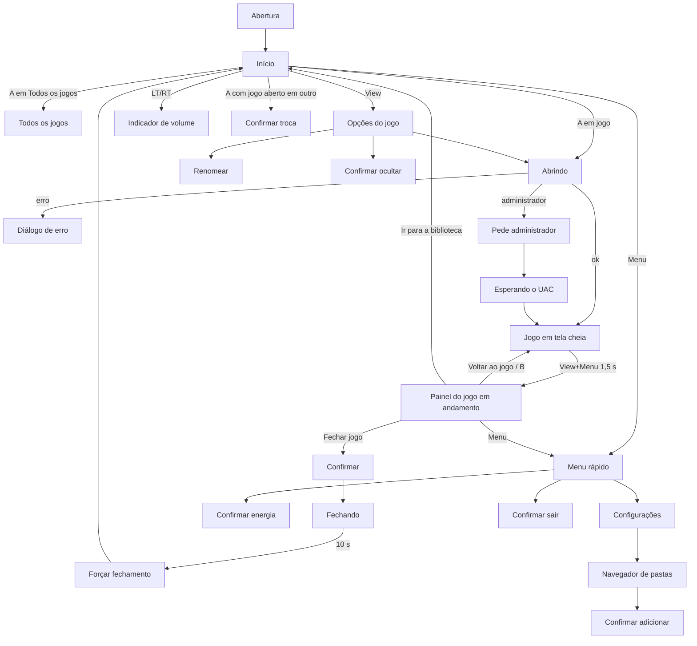

# Design: launcher-tv (Sofá)

| Campo | Valor |
|---|---|
| Feature | launcher-tv (MVP) |
| Spec | `docs/specs/launcher-tv.md` |
| Marca | `docs/brand/sofa/` (direção A, "Palco") |
| Mockups | `docs/design/launcher-tv/mockups/index.html` |
| Microcopy | `docs/design/launcher-tv/microcopy.md` |
| Status | Mockups aprovados pelo usuário (DES-08 feito). Catálogo de erros fechado contra o contrato rev. 2 (DES-07 feito) |

Os mockups moram em `mockups/`, não direto em `docs/design/launcher-tv/` como diz a tabela de tarefas. As telas que a tabela chama de `home.html`, `opcoes-jogo.html`, `sessao.html`, `menu-rapido.html`, `configuracoes.html`, `navegador-pastas.html` e `componentes.html` estão em `mockups/` com os mesmos nomes.

## 1. Direção

A interface é uma TV lida a 3 m, controlada só com D-pad e botões. A marca "Palco" vira o conceito: o item em foco é o ator sob o holofote e o resto recua.

- Fundo tinta (`--brand-ink`), cartazes verticais 2:3 que ecoam o cartaz do logo.
- Foco com anel duplo, halo âmbar e escala 1,06. Os outros cards a 72% de opacidade. Em menus e botões o item em foco vira bloco âmbar com texto tinta.
- Um holofote (`--gradient-spotlight`) acompanha o card em foco e desliza junto com ele. O fundo desfocado vem da capa do jogo em foco.
- Herói fixo no alto com nome, origem e último jogado. Nome inteiro aqui, truncado no card (E-13).
- Pouca informação por tela. Rodapé de dicas com os botões que valem na tela.

Esta interface é só de TV. Não existe versão mobile nem tablet (a spec descarta toque). A seção 8 explica.

## 2. Fluxo do usuário

Decisões do fluxo:
- A tela inicial ignora B (CA-10). Todas as outras voltam um nível com B.
- Fechar jogo tem duas confirmações com "Cancelar" em foco: a de fechar e a oferta de forçar (RN-12). A oferta de forçar já é a segunda confirmação; não há uma terceira.
- "Ir para a biblioteca" não minimiza o jogo (D-19). O card ganha o selo "Em andamento" e A nele volta ao jogo.
- Jogo que pede administrador tem uma etapa a mais que a spec: primeiro um aviso com "Continuar", depois o Windows mostra o UAC. É consequência da arquitetura (`NeedsElevation` antes de `session_launch_with_uac`). Ver dúvida 1.

## 3. Telas

Todas em `mockups/<arquivo>.html`. A coluna "Estados" lista o que o playground alterna.

| Tela | Arquivo | CA | Componentes | Estados |
|---|---|---|---|---|
| Abertura | `boot.html` | CA-01, CA-03, M-02 | `BootSplash` (usa `assets/splash.svg`) | barra completa, parada |
| Início | `home.html` | CA-06, 13, 14, 15, 22, 23, 24, 36, 60, 64, RN-05, E-13 | `HeroGame`, `GameRow`, `GameCard`, `OriginBadge`, `InProgressBadge`, `ControllerBanner`, `VolumeHud`, `EmptyLibrary` | cheia, nomes longos e extremos, 80 jogos, um jogo, vazia, carregando, jogo em andamento, sem controle, controle desconectou e voltou |
| Todos os jogos | `home.html` | CA-22, 60, 64 | `GameGrid` (7 colunas, virtualizada) | 80 jogos |
| Opções do jogo | `opcoes-jogo.html` | CA-21, 61, 62, RN-04, 14, 22 | `MenuList`, `RenameDialog`, `ConfirmDialog` | com e sem "Restaurar nome original", nome vazio recusado, confirmar ocultar |
| Fluxo de jogo | `sessao.html` | CA-26, 28, 29, 31, 32, 34, 35, 36, 63, 71, 73, E-10 | `ConfirmDialog`, `LaunchingOverlay`, `SessionPanel` | abrindo, arquivo sumiu, pasta de rede, não confirmado, loja ausente, administrador, UAC, troca de jogo, painel (normal, minimizado, administrador), fechar, fechando, forçar, forçar sem permissão, voltar recusado |
| Menu rápido | `menu-rapido.html` | CA-05, 37, 38, 39, 42, 43, 47, 48, RN-14 | `QuickMenu`, `Slider`, `Switch`, `ConfirmDialog` | normal, com jogo aberto, sem áudio, sem suspensão, confirmar desligar, reiniciar e suspender (com e sem jogo aberto), sair |
| Configurações | `configuracoes.html` | CA-04, 19, 20, 66, 67, 70 | `SettingsTabs`, `SettingsPane`, `MenuItem` | monitores (dois, um, ausente), biblioteca, geral (ligado, desligado, falha), ocultos (4, nenhum, 30) |
| Navegador de pastas | `navegador-pastas.html` | CA-19, 20, 71, 72, SEC-09 | `FolderBrowser`, `ConfirmDialog` | unidades, pasta, vazia, sem permissão, 60 itens, adicionar, duplicado, inválido |
| Avisos | `avisos.html` | CA-13, 14, 15, 28, 29, 42, 47, 71, 72, 73 | os mesmos | reúne os avisos dos outros arquivos |
| Componentes | `componentes.html` | CA-03, 24, 54, 55, 60, RN-14, E-13 | folha de estilo | foco, capas, avisos, diálogo, escala de texto |
| Protótipo | `prototipo.html` | CA-09, 10, 55 | tudo ligado | começa na abertura |

## 4. Mapa de foco por tela

Regra geral: exatamente um item em foco por tela (CA-55). A abertura e o jogo em tela cheia são passivos e ficam sem foco. Em overlays o foco fica só na camada do topo e a de baixo perde o anel. Itens desabilitados são pulados pelo foco e têm o motivo escrito.

Movimento: D-pad ou analógico. Ao segurar, repete após 400 ms. Os extremos não dão a volta. Ao subir ou descer, a coluna lembrada é mantida.

| Tela | Foco inicial | Eixos | A | B | Menu | View | Outros |
|---|---|---|---|---|---|---|---|
| Início | último jogado (CA-22); sem recentes, o primeiro de A a Z | ←→ dentro da linha, ↑↓ entre Recentes e Biblioteca | Jogar, ou "Todos os jogos" | nada | menu rápido | opções do jogo | LB e RB pulam linha; LT e RT volume |
| Início vazio | Adicionar jogo | ←→ entre Adicionar jogo e Atualizar biblioteca | executa | nada | menu rápido | nada | |
| Início carregando | Adicionar jogo | só ele | abre o navegador | nada | menu rápido | nada | |
| Todos os jogos | jogo que estava em foco | grade 7 colunas, ←→↑↓ | Jogar | volta | menu rápido | opções | LB e RB pulam 3 linhas; LT e RT volume |
| Opções do jogo | Jogar | ↑↓ | executa | fecha | nada | nada | |
| Renomear | campo de texto | ↓ vai para os botões, ↑ volta | Cancelar ou Salvar (nos botões, nesta ordem) | cancela | nada | nada | Enter salva e Esc cancela no teclado |
| Diálogo de confirmação | Cancelar (RN-14) | ←→ | executa | cancela | nada | nada | |
| Erro com recuperação | opção segura (Voltar) | ←→ | executa | Voltar | nada | nada | |
| Abrindo e Fechando | Voltar / Ir para a biblioteca | só ele | executa | o mesmo botão | nada | nada | A fica travado por 600 ms |
| Painel do jogo | Voltar ao jogo | ↑↓ | executa | Voltar ao jogo (CA-34) | menu rápido | nada | |
| Menu rápido | Volume (sem áudio: Desligar) | ↑↓; ←→ no Volume muda 5 pontos | executa | fecha | fecha | nada | LT e RT ignorados (CA-65) |
| Configurações, abas | aba "Tela" | ↑↓ troca a aba e o painel | entra no painel | sai | nada | nada | → entra no painel |
| Configurações, painel | primeiro item | ↑↓ | executa | volta às abas | nada | nada | ← volta às abas |
| Navegador de pastas | primeira entrada; pasta vazia ou sem acesso: Voltar | ↑↓ | abre pasta ou escolhe .exe | pasta anterior; na raiz, sai | nada | nada | |
| Confirmar adicionar | Adicionar | ←→ | executa | cancela | nada | nada | |

Ao fechar uma camada, o foco volta ao item que a abriu. Ao ocultar um jogo, vai para o primeiro recente (ou o primeiro de A a Z).

## 5. Estados

| Situação | Comportamento na tela |
|---|---|
| Vazio | "Nenhum jogo por aqui", com Adicionar jogo em foco (CA-23) |
| Carregando | esqueleto de cards, "Procurando jogos…", sem bloquear o menu. Em uso normal a biblioteca vem do cache e só aparece o chip "Atualizando biblioteca…" no cabeçalho |
| Erro de loja | não aparece (CA-18, CA-59). Só vai para o log |
| Erro de ação | diálogo com a causa e a opção segura em foco. Textos em `microcopy.md` |
| Controle ausente | faixa no topo, sem tirar o foco (CA-13, CA-14). Aceita teclado e mouse |
| Controle voltou | a faixa fica verde por 1,5 s com "Controle conectado." e some (CA-15, até 2 s) |
| Jogo em andamento | selo "Em andamento" no card, herói diz "Em andamento. Aperte A para voltar ao jogo.", A volta ao jogo |
| Sem áudio | Volume e Mudo desabilitados com o texto da spec; indicador mostra "Sem áudio" |
| Sem suspensão | Suspender desabilitado, com "Suspensão indisponível neste PC" |
| Sem permissão | pasta: "Sem permissão para abrir esta pasta". Forçar fechamento de jogo administrador: aviso próprio |
| Dados extremos | nome longo trunca no card e quebra em 2 linhas no herói; placeholder corta em 5 linhas; HTML no nome aparece literal; 80 jogos e 60 pastas rolam com o foco sempre visível |

## 6. Tokens

Tudo vem de `docs/brand/sofa/tokens.css`, importado sem cópia. Nenhuma cor ou fonte nova.

| Uso | Token |
|---|---|
| Fundo da tela | `--brand-ink` |
| Barras, cards, listas dentro de painel | `--brand-surface` |
| Menus, diálogos, painel de configurações | `--brand-surface-raised` |
| Texto | `--brand-text`; secundário e dicas `--brand-text-muted` |
| Foco e ação | `--brand-primary` e `--brand-on-primary` |
| Destrutivo e erro | `--brand-danger` |
| Sucesso e switch ligado | `--brand-success` |
| Escala de texto | `--text-caption` 24, `--text-body` 28, `--text-label` 32, `--text-card-title` 40, `--text-heading` 48, `--text-display` 72 |
| Nome no herói | 68 px a 1080p (entre display e heading), Sora 800 |
| Espaço | `--space-1` a `--space-12` |
| Raios | `--radius-card`, `--radius-card-focus`, `--radius-button`, `--radius-dialog`, `--radius-pill` |
| Foco | `--focus-ring`, `--glow-spotlight`, `--focus-scale`, `--focus-dim-others` |
| Capa sem imagem | gradiente `#322a68` a `#1b1540` e nome em Sora 700 |
| Movimento | `--dur-fast`, `--dur-base`, `--dur-slow`, `--ease-out` |

Em Configurações > Tela o monitor mostra só nome, "Principal" e "Em uso" (sem resolução).

Medidas próprias do mockup, em unidades `calc(N * var(--u))`: card 220 × 330, espaço entre cards 20, cabeçalho 64, rodapé de dicas 56, item de menu 80 de altura, botão 84, menu rápido 760 de largura, diálogo 1040.

Tinturas de apoio (14% de opacidade sobre a superfície) para os círculos de ícone: `--brand-primary`, `--brand-danger`, `--brand-success`. A janela do UAC é desenhada em cinza claro de propósito: ela é do Windows, não do Sofá.

## 7. Componentes

Reusados da marca: `Focusable` (`.focusable[data-focused]` do `tokens.css`), logo, ícone, `splash.svg`, fontes.

Novos, para o dev-frontend:

| Componente | Observações |
|---|---|
| `SafeArea` | `--safe-x`/`--safe-y` já vêm da marca |
| `GameCard` / `GamePoster` | 2:3. Capa (`CoverImage`), `CoverPlaceholder` (gradiente + nome) ou ícone do executável. `OriginBadge` embaixo à esquerda, `InProgressBadge` no alto. Nome em 1 linha embaixo |
| `GameRow` | rolagem horizontal que centraliza o card em foco |
| `HeroGame` | origem, último jogado, nome em até 2 linhas. Atualiza ao mover o foco |
| `MenuList` / `MenuItem` | linha com ícone, rótulo, apoio opcional e controle à direita (Switch, Slider, chevron). Em foco: bloco âmbar |
| `ConfirmDialog` | ícone ou capa, título, texto, aviso de jogo aberto, botões. `defaultFocus` obrigatório. Trava de A por 600 ms em diálogos de espera |
| `ControllerBanner` | pílula no topo, três tons (aviso, desconectado, ok). Não toma foco |
| `VolumeHud` | pílula no canto superior direito, 2 s, mudo e sem áudio |
| `Toast` | confirmação curta embaixo, 3,2 s, sem foco |
| `Switch`, `Slider` | só visuais, o foco é da linha |
| `SettingsTabs` + `SettingsPane` | duas zonas de foco; ← e → trocam |
| `FolderBrowser` | lista com Drive, Dir e Exe |
| `ButtonHints` | rodapé com glifos A, B, View, Menu, LB, RB, LT, RT |

Regras:
- Em listas com rolagem o halo seria cortado. Nelas o foco usa só o anel. Nos carrosséis de capas o container tem folga de 140 px para o halo.
- Foco sempre calculado pela camada do topo. As camadas de baixo recebem `data-focused="false"`.
- O fundo desfocado e o holofote são decorativos. Se pesarem no uso do launcher em segundo plano (RN-21), podem sair sem afetar nada.

## 8. Desktop e mobile

Não se aplica. A spec define uma interface de 10 pés, 1920×1080 e 3840×2160, controlada por controle. Mouse e teclado são só emergência (RN-07). Não há breakpoints, toque, teclado virtual nem safe area de celular.

O que vale no lugar:
- Escala: `--u = 100vh / 1080`; 4K é o dobro. Os mockups foram conferidos nas duas resoluções.
- Área segura de 5% em cada borda para texto e itens focáveis. O anel de foco e o halo respeitam a área no primeiro e no último card (a fila começa com 28 px de folga).
- Cursor do mouse some após 3 s parado (CA-03).
- Teclado de emergência (RN-07, D-45): cobre todas as ações do controle. Tabela abaixo.
- Ordem dos botões nos diálogos (RN-34, CA-81, D-47): Cancelar ou Voltar à esquerda, ação principal à direita. O foco padrão não muda com a posição.

### Teclado de emergência: tecla → ação do controle

Mapa final, igual a `ui/src/shared/input/keyboard.ts` (D-45). As intenções vêm de `ui/src/shared/input/intents.ts`.

| Tecla | Intenção | Ação equivalente do controle |
|---|---|---|
| ↑ ↓ ← → | `Up` `Down` `Left` `Right` | D-pad: mover foco, trocar aba, ajustar volume no menu rápido |
| Enter | `Confirm` | A: jogar, escolher, confirmar, voltar ao jogo |
| Esc ou Backspace | `Back` | B: voltar, cancelar, fechar |
| F1 ou tecla de aplicativo | `Menu` | Menu: abre o menu rápido |
| F2 | `View` | View: opções do jogo na biblioteca. O painel do jogo em andamento vem do núcleo (combinação de retorno), não desta tecla |
| PgUp / PgDn | `PagePrev` / `PageNext` | LB / RB: pular linhas (Início) ou 3 linhas (Todos os jogos) |
| `[` / `]` | `VolumeDown` / `VolumeUp` | LT / RT: volume (só na biblioteca; ignorados no menu rápido, CA-65) |

Dentro de um campo de texto só Enter, Esc e ↑↓ saem do campo.

Sem tecla: View + Menu (combinação de retorno). Só existe no controle (RN-07, CA-80). F1 e F2 são o equivalente do teclado para Menu e View, não para a combinação. No devCore, F9 simula a combinação (só em desenvolvimento).

Mudo e as ações de energia ficam no menu rápido, que o teclado abre com F1.

## 9. Acessibilidade

- Contraste: pares da marca, todos acima de 4,5:1 para texto e 3:1 para anel e ícones. Texto âmbar corrido e violeta de apoio como texto não são usados. Sobre capas, o selo de origem tem fundo escuro (`rgba(11,8,28,.82)`).
- Texto mínimo de 24 px a 1080p (legenda), corpo a 28 px.
- Foco visível a 3 m: anel de 14 px de âmbar, bloco âmbar em menus, escala em cards. Nunca depende só de cor: forma e escala mudam.
- Movimento reduzido: sem escala nem halo animado, só o anel; entradas de diálogo e toasts sem animação; spinner mais lento. O playground tem o botão "Reduzir movimento" e a marca respeita `prefers-reduced-motion`.
- Semântica para leitor de tela (Narrador do Windows pode ler a TV): `role="alertdialog"` + `aria-modal` nos diálogos, `aria-labelledby` no título, `role="menu"`/`menuitem`, `role="slider"` com `aria-valuenow` no volume, `role="switch"` com `aria-checked`, `aria-live="polite"` em herói, aviso de controle, volume e toast, `aria-disabled` nos itens desabilitados, `aria-label` nos cards com "nome, origem".
- Confirmação nunca depende de um toque único em ações destrutivas: foco inicial em Cancelar, B cancela.
- Teclado: tudo operável (RN-07). Dentro do campo de texto só Enter, Esc e ↑↓ saem do campo.

## 10. Animações

| Elemento | Gatilho | Efeito | Duração e curva |
|---|---|---|---|
| Card, botão, item em foco | mover foco | escala 1,06, anel, halo | 160 ms, `--ease-out` |
| Holofote | mover foco | desliza para a coluna do card | 320 ms, `--ease-out` |
| Linha de capas | mover foco | rola até centralizar o card | 320 ms, suave |
| Diálogo e menu | abrir | fade + escala de 0,96 a 1 | 200 ms, `--ease-out`. Fechar sem animação |
| Menu rápido | abrir | desliza 48 px da direita | 200 ms |
| Faixa do controle | aparecer | desce 16 px | 200 ms |
| Indicador de volume | cada passo | desce 16 px e some após 2 s | 160 ms |
| Toast | aparecer | sobe 16 px, some após 3,2 s | 200 ms |
| Spinner e selo "Em andamento" | contínuo | giro e pulso | 0,9 s linear; 1,6 s |
| Barra da abertura | carregar | preenche | 1,8 s |

Troca de foco por D-pad repetido não anima além da escala (uso de centenas de vezes por sessão). Só `transform`, `opacity` e `box-shadow`.

## 11. Specs para o dev-frontend

- Importar `tokens.css` e não duplicar tokens. Ajustar o `url()` das fontes ao bundle (`font-src 'self'`).
- Um único item com `data-focused="true"` em todo o documento, calculado da camada do topo.
- Dados externos só por JSX como texto (SEC-07). O mockup tem um jogo chamado `` para testar.
- A UI traduz `ErrorDto.code` com a tabela de `microcopy.md` (seção 2). `PathNotAllowed` precisa de contexto: cadastro e navegador usam um texto, início de jogo usa o da rede (dúvida 3).
- Confirmações sempre com `defaultFocus` explícito. Diálogos de espera (Abrindo, Fechando) ignoram A por 600 ms.
- Rolagem: manter o card em foco inteiro dentro da área visível com 10 px de folga.
- Linha de capas: o card em foco centraliza, exceto nas pontas.
- A combinação de retorno não tem UI no jogo (o Sofá está em segundo plano). O quadro "Simulação" do mockup não existe no produto.
- Ordem de revisão visual (DES-09): comparar com `mockups/` nas duas resoluções e com movimento reduzido.

## 12. Decisões de design

1. Capas em cartaz vertical 2:3, como o logo.
2. Início com herói fixo e duas linhas (Recentes e Biblioteca). "Todos os jogos" é o último card da segunda linha.
3. Opções do jogo (View) inclui "Jogar" como primeiro item, porque o pedido pediu detalhe com Jogar e Ocultar. A tela de detalhe separada foi descartada: A já joga com um clique (M-03).
4. Painel do jogo em andamento é um diálogo centrado sobre a imagem do jogo, com "Voltar ao jogo" em foco (não destrutivo) e "Fechar jogo" em vermelho.
5. Menu rápido é um painel à direita, para o jogo e a biblioteca continuarem visíveis.
6. Itens desabilitados saem da ordem de foco e explicam o motivo por escrito.
7. Telas de espera têm um botão focável (Voltar, Ir para a biblioteca) para cumprir "um item em foco". Ver dúvida 2.
8. Faixa de controle no topo em vez de diálogo, para não tirar foco nem bloquear (CA-14).
9. Sobre o aviso de elevação: fica na aba Geral, e não numa tela própria.

## 13. Decisões do usuário (aprovação dos mockups)

1. Administrador em duas etapas: mantido. Aviso com "Voltar | Continuar" antes do UAC (ordem da D-47).
2. Telas de espera ("Abrindo…", "Fechando…") com botão focável: mantido.
3. Caminho de rede terá código próprio, `NetworkPathBlocked`, que o dev-backend inclui no contrato. `PathNotAllowed` fica só para cadastro e navegador. Texto de `NetworkPathBlocked`: "Jogos em pastas de rede não são aceitos. Copie o jogo para um disco deste PC." (Voltar · Ocultar, foco em Voltar). Já está no catálogo de `microcopy.md`.
4. Card parcial na borda da tela: aceito como continuação visual. Texto e itens focáveis ficam dentro da área segura.
5. Contrato de erros: DES-07 segue aberta até o BE-07; conferir os códigos quando sair.
6. Teclas extras do mockup (V, M, espaço) valem só no mockup. As do teclado de emergência estão na seção 8 e dependem da confirmação do front (D-45).

## 14. Verificação feita

- Todas as telas e estados abertos em 1080p e 4K em Chrome headless, sem erro de script.
- Varredura de 51 cenários em 6 bibliotecas: um único item em foco em todos os que têm interação.
- Fluxos executados por intenções: jogar com trava de duplo A, combinação de retorno, painel, ir para a biblioteca, trocar de jogo, aviso de energia com jogo aberto, fechar, ocultar, renomear (inclusive vazio), restaurar, adicionar jogo, volume e mudo (CA-40).
- Playground sem rolagem horizontal em 1366 px.
- **Não verificado:** controle Xbox real (a Gamepad API foi implementada pelo mapeamento "standard", mas não testada com hardware); contraste medido por ferramenta (usei os pares validados da marca); leitura em TV real.

## 15. Aprovação

Aprovado pelo usuário. Ajustes futuros vão para o mockup e este arquivo juntos.

Processo original: O usuário abre `mockups/index.html`, testa o protótipo e devolve o prompt copiado de cada playground. Os ajustes pedidos vão para o mockup e para este arquivo juntos.

## 16. Ajustes pós-implementação (FE-09 a FE-14)

Validados em conjunto com o front. Textos finais em `microcopy.md`, seção 3.

1. **Lista cortada** no navegador de pastas: aprovado. "A lista foi cortada. Mostrando só as primeiras 2.000 entradas desta pasta."
2. **Configurações > Geral**: "Inicialização" e "Pasta de logs" aprovados. Ajuste de texto nos valores: "Tarefa agendada do Windows", "Entrada de inicialização do seu usuário" (no lugar de "Chave Run do seu usuário") e "Desligada".
3. **A no card "Em andamento" durante Fechando ou fechamento atrasado**: aprovado. Reabre "Fechando <nome>…" ou a oferta de forçar, com a mesma trava de 600 ms e B para a biblioteca. É um atalho do caminho do CA-78 (card, painel, forçar) e mantém a espera sem botão extra.
4. **Resolução do monitor**: não é necessária. O mockup deixou de mostrar "2560 × 1440". Sem pedido ao back.
5. **"Jogando há N min"**: reiniciar após Fechando e depois Cancelar na oferta de forçar mostra "Jogando agora" para um jogo aberto há horas, o que é errado. Não precisa de pedido ao back: o front guarda o primeiro `since` de `Running` do mesmo jogo e só o descarta quando a sessão volta a `Idle`.
6. **Catálogo de erros** fechado: 26 de 26 códigos do contrato rev. 2, com texto igual ao de `errors.ts`.
7. **`GameFileMissing`** mostra o nome do jogo, sem o caminho, porque o caminho não cruza a IPC (SEC-03). A frase do CA-28 ("em <caminho>") fica diferente da spec. Pendência de spec para o PO.
