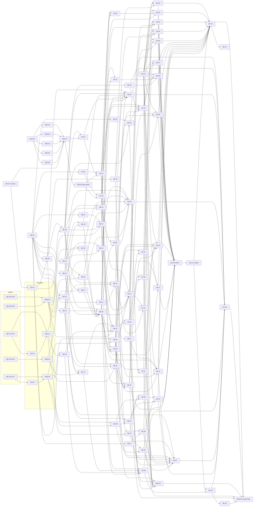
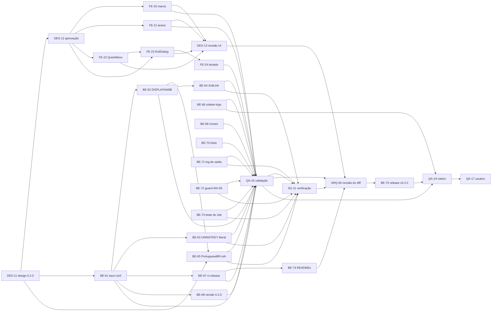

# Backlog — launcher-tv (Sofá)

| Campo | Valor |
|---|---|
| Spec | `docs/specs/launcher-tv.md` (CA-01 a CA-79, RN-01 a RN-33, decisões D-01 a D-40; revisada após a aprovação dos mockups) |
| Design | `docs/design/launcher-tv.md` (handoff; DES-01 a DES-08 concluídos) |
| Arquitetura | `docs/arch/launcher-tv.md` (rev. 2) + ADRs 0001 a 0006 (0003, 0005 e 0006 `proposed` até os spikes) |
| Segurança | `docs/security/launcher-tv.md` rev. 2 (SEC-01 a SEC-32, AF-01 a AF-10; emendas em SEC-08, SEC-10, SEC-21, SEC-22, SEC-25, SEC-28, SEC-29; DR-03 decidido: desinstalar apaga só os dados do usuário interativo) |
| Marca | `docs/brand/sofa/` (concluída) |
| Branch | `feature/launcher-tv-20261113` (base `main`) |
| Painel | `docs/tasks/launcher-tv/painel.html` |
| Data | 2026-11-13 |

## Agentes e arquivos

| Agente | Arquivo | Tarefas | Papel nesta feature |
|---|---|---|---|
| dev-backend | `dev-backend.md` | 43 (BE-01 a BE-43) | Spikes técnicos, contrato (comandos Tauri + eventos), núcleo Rust, persistência JSON, instalador e desinstalador |
| dev-frontend | `dev-frontend.md` | 14 (FE-01 a FE-14) | UI React no WebView2 |
| designer-ux | `designer-ux.md` | 9 (DES-01 a DES-09) | Mockups HTML sobre os tokens da marca, microcopy, aprovação com o usuário, revisão da UI |
| qa | `qa.md` | 17 (QA-01 a QA-17) | Plano, E2E, testes em VM e com apps sintéticos, segurança dinâmica, roteiro único do usuário, relatório |
| seguranca | `seguranca.md` | 10 (SG-01 a SG-10) | Revisão do contrato, dos spikes SP-01 e SP-07 e dos ADRs revisados, verificação do código, decisão final dos degraus 2 e 3 |
| arquiteto | `arquiteto.md` | 5 (ARQ-01 a ARQ-05) | Fechar ADRs com os spikes técnicos, revisão final |

Total: 98 tarefas. A rev. 2 do threat model acrescentou BE-41, BE-42, SG-09 e QA-15; o replanejamento sem o usuário nos spikes acrescentou QA-16, QA-17, SG-10 e BE-43.

**Decisões do usuário (painel):** D-29 lista de jogos enviada depois; D-30 anti-cheat testado em modo offline, no fim; D-31 conta padrão + outro admin testados no fim; D-32 PC da sala é Windows 10 (alvo principal), Windows 11 secundário; D-33 hardware ausente = "não verificado"; D-34 CI = `scripts/ci.ps1` local + pasta de releases; D-35 o usuário só testa no fim, sem spikes com ele. Não participam: modelador-bd (sem banco; a persistência JSON do ADR-0004 está em BE-11), designer-marca (concluído) e produto (só se o escopo mudar).

Status: todas começam em `a fazer`. Valores aceitos: `a fazer`, `em andamento`, `feito`, `bloqueado: <motivo>`.

## Ordem de execução

| Fase | Tarefas | Observação |
|---|---|---|
| 0. Já pode começar | BE-01 a BE-05 (spikes técnicos), BE-06, BE-07, DES-01, QA-01 | Spikes na máquina de dev e em VM, com apps sintéticos; não dependem do usuário |
| 1. Decisões e base | SG-01, SG-02, SG-03, ARQ-01 a ARQ-04; BE-08 a BE-13, BE-19, BE-22, BE-23, BE-31; FE-01; DES-02 a DES-06 | Contrato revisado (SG-01) antes de BE-08 e BE-10; ADRs fechados antes dos módulos que dependem deles |
| 2. Módulos do núcleo e aprovação do design | BE-14 a BE-18, BE-24 a BE-28, BE-32 a BE-36; SG-09; DES-07, DES-08; FE-02 | DES-08 é a aprovação dos mockups pelo usuário: nenhuma tela do front começa antes. SG-09 confere os ADRs 0003 e 0006 revisados |
| 3. Fluxos e telas | BE-20, BE-21, BE-29, BE-30, BE-37 a BE-42; FE-03 a FE-14 | Fatias verticais: cada tela entra quando o comando do núcleo correspondente fica pronto. Desinstalador (BE-38, BE-41, BE-42) só depois de SG-09 |
| 4. Verificação sem o usuário | QA-02 a QA-12, QA-15, SG-04 a SG-07, DES-09 | QA (automatizado, apps sintéticos, VMs Windows 10 e 11) e seguranca verificam juntos |
| 5. Roteiro do usuário | QA-16 (prepara exe + passo a passo + coletor de logs), QA-17 (usuário executa no PC da sala; QA analisa) | Única participação do usuário em teste, além da aprovação dos mockups (DES-08) |
| 6. Fechamento | SG-10, BE-43, QA-13, SG-08, ARQ-05; depois QA-14 (2 semanas de uso, não bloqueia) | SG-10 decide os degraus 2 e 3 com os logs reais; BE-43 aplica |

## Caminho crítico

```text
BE-01 (SP-01 técnico) → SG-02 → ARQ-01 → BE-14 / BE-18 → BE-20 → BE-21 → FE-09 → QA-06 → QA-16 → QA-17 (usuário) → SG-10 → BE-43 → ARQ-05
```

SG-10 também libera SG-08 e QA-17 libera QA-13; os dois entram em ARQ-05 em paralelo com BE-43.

Entram nesse caminho por BE-20, FE-09 e QA-16:

- **Contrato**: BE-07 → SG-01 → BE-10 → BE-14.
- **Biblioteca**: BE-03 (SP-08) → ARQ-04 → BE-25/26/27 → BE-29 → BE-20.
- **Design**: DES-01 → DES-02..06 → DES-07 → DES-08 (aprovação do usuário) → FE-03 → FE-05 → FE-08 → FE-09.
- **Instalador**: BE-04 → SG-03 → ARQ-03 → BE-37 → BE-39 → QA-16 (o roteiro usa o instalador de release).

Os spikes não esperam mais pelo usuário. O risco de atraso passa para a aprovação dos mockups, para a lista de jogos (D-29, necessária só no QA-16) e para a disponibilidade do usuário em executar o roteiro (QA-17).

**Em paralelo**: os 5 spikes entre si; BE-06/BE-07/DES-01/QA-01 junto com os spikes; domínio puro (BE-13, BE-15, BE-22, BE-23, BE-31) enquanto os ADRs fecham; scanners Steam, Epic e GOG (BE-25, BE-26, BE-27) entre si; volume (BE-31, BE-32), energia (BE-33), monitor (BE-34) e instalação (BE-35 a BE-39) em trilhas separadas; telas FE-06, FE-07, FE-10, FE-11 e FE-12 depois de FE-03/FE-04.

## Tarefas que dependem do usuário

| Tarefa | O que precisa | Dúvida |
|---|---|---|
| DES-08 | Aprovar os mockups | — |
| QA-16 | Enviar a lista de jogos (nome, loja, modo de tela) antes de o roteiro ser fechado | D-29 |
| QA-17 | Executar o roteiro único no PC da sala (Windows 10): instalar, boot, controle, jogos em cada modo, anti-cheat em modo offline, energia, TV, conta padrão + outro admin, desinstalar; rodar o coletor e devolver o zip | D-30, D-31, D-32, D-33, D-35 |
| QA-14 | 2 semanas de uso real (não bloqueia a revisão final) | — |

As dúvidas do painel começam em D-29 porque a spec já usa D-01 a D-28 para as decisões registradas.

## Grafo de dependências



## Matriz de cobertura

"Implementa" inclui spikes e design que alimentam a entrega. "Verifica" é a tarefa de teste (QA) ou de verificação (SG/DES) que confirma o critério.

### Critérios de aceite

| CA | Implementa | Verifica |
|---|---|---|
| CA-01 | BE-34, BE-36, BE-40 | QA-09, QA-10 |
| CA-02 | BE-35 | QA-10 |
| CA-03 | BE-08, FE-03, DES-01 | QA-09 |
| CA-04 | BE-36, FE-12, DES-06 | QA-10 |
| CA-05 | BE-35, FE-10, DES-05 | QA-08 |
| CA-06 | BE-13, BE-14, FE-03, DES-02 | QA-03 |
| CA-07 | BE-13, FE-03 | QA-03 |
| CA-08 | BE-13 | QA-03 |
| CA-09 | FE-03, DES-08 | QA-02, QA-03 |
| CA-10 | FE-03, DES-08 | QA-02, QA-03 |
| CA-11 | BE-13, BE-14 | QA-03 |
| CA-12 | BE-13, BE-14, BE-20 | QA-03, QA-06 |
| CA-13 | BE-14, FE-06, DES-02, DES-07 | QA-03 |
| CA-14 | BE-14, FE-06, DES-02 | QA-03 |
| CA-15 | BE-14, FE-06, DES-02 | QA-03 |
| CA-16 | BE-03, BE-25, BE-28, BE-29, FE-12 | QA-04 |
| CA-17 | BE-25, BE-29 | QA-04 |
| CA-18 | BE-25, BE-29 | QA-04 |
| CA-19 | BE-24, BE-28, BE-30, FE-13, DES-06 | QA-05 |
| CA-20 | BE-22, BE-30, FE-13, DES-06, DES-07 | QA-05 |
| CA-21 | BE-22, BE-29, FE-07, DES-03 | QA-04 |
| CA-22 | BE-22, BE-29, FE-05, DES-02 | QA-04 |
| CA-23 | FE-05, DES-02 | QA-04 |
| CA-24 | BE-28, FE-04, DES-01, DES-02 | QA-04 |
| CA-25 | BE-11, BE-22, BE-29 | QA-12 |
| CA-26 | BE-16, BE-20, FE-04, FE-08, DES-04 | QA-06 |
| CA-27 | BE-16, BE-18, BE-20 | QA-06 |
| CA-28 | BE-20, BE-30, FE-08, DES-04, DES-07 | QA-05, QA-06 |
| CA-29 | BE-02, BE-15, BE-20, FE-08, DES-04 | QA-06 |
| CA-30 | BE-15, BE-17, BE-18, BE-21 | QA-06 |
| CA-31 | BE-15, BE-20, FE-08, DES-04 | QA-06 |
| CA-32 | BE-01, BE-18, BE-21, BE-43, FE-09, DES-04 | QA-06, QA-17, SG-10 |
| CA-33 | BE-13 | QA-06 |
| CA-34 | BE-18, BE-21, FE-09, DES-04 | QA-06 |
| CA-35 | BE-15, BE-21, FE-04, FE-09, DES-04 | QA-06 |
| CA-36 | BE-21, FE-05, FE-09, DES-02, DES-04 | QA-06 |
| CA-37 | FE-09, FE-10, DES-05 | QA-06 |
| CA-38 | BE-31, BE-32, FE-10, DES-05 | QA-07 |
| CA-39 | BE-31, FE-10, DES-05 | QA-07 |
| CA-40 | BE-31, FE-10, FE-11 | QA-07 |
| CA-41 | BE-32, FE-10 | QA-07 |
| CA-42 | BE-32, FE-10, DES-05 | QA-07 |
| CA-43 | BE-33, FE-04, FE-10, DES-05 | QA-02, QA-08 |
| CA-44 | BE-33, FE-10 | QA-08 |
| CA-45 | BE-33, FE-10 | QA-08, QA-10 |
| CA-46 | BE-19, BE-33, FE-10, FE-14 | QA-08 |
| CA-47 | BE-33, FE-10, DES-05 | QA-08 |
| CA-48 | FE-10, DES-05 | QA-08 |
| CA-49 | BE-33 | QA-08 |
| CA-50 | BE-37, DES-07 | QA-10 |
| CA-51 | BE-04, BE-36, BE-37 | QA-10 |
| CA-52 | BE-38, BE-42 | QA-10, QA-15 |
| CA-53 | BE-37 | QA-10 |
| CA-54 | DES-01, FE-03, FE-04, FE-05 | QA-09, DES-09 |
| CA-55 | DES-01, FE-03, FE-04 | QA-03, QA-09, DES-09 |
| CA-56 | BE-26, BE-28, BE-29 | QA-04 |
| CA-57 | BE-27, BE-28, BE-29 | QA-04 |
| CA-58 | BE-26, BE-27, BE-29 | QA-04 |
| CA-59 | BE-26, BE-27, BE-29 | QA-04 |
| CA-60 | BE-22, FE-04, FE-05, DES-02 | QA-04, DES-09 |
| CA-61 | BE-29, FE-07, DES-03 | QA-04 |
| CA-62 | BE-22, BE-29, FE-07, DES-03 | QA-04 |
| CA-63 | BE-01, BE-18, BE-21, BE-43, FE-09, DES-04 | QA-06, QA-17, SG-10 |
| CA-64 | BE-13, BE-31, FE-11, DES-02 | QA-07 |
| CA-65 | BE-13, FE-11 | QA-07 |
| CA-66 | BE-19, BE-34, FE-12, DES-06 | QA-09 |
| CA-67 | BE-19, BE-34, FE-12 | QA-09 |
| CA-68 | BE-38, BE-41 | QA-10, QA-15 |
| CA-69 | BE-22, BE-25 | QA-04 |
| CA-70 | BE-29, FE-12, DES-06 | QA-04 |
| CA-71 | BE-07, BE-23, BE-24, BE-30, FE-02, FE-08, FE-13, DES-04, DES-06, DES-07 | QA-05 |
| CA-72 | BE-30, FE-13, DES-06 | QA-05 |
| CA-73 | BE-16, BE-20, FE-08, DES-04 | QA-06, QA-17 |
| CA-74 | BE-09, BE-36 | QA-10 |
| CA-75 | BE-11, BE-20, BE-22 | QA-06, QA-12 |
| CA-76 | BE-39 | QA-10 |
| CA-77 | BE-07, BE-20, FE-04, FE-08 | QA-06, QA-17, DES-09 |
| CA-78 | BE-07, BE-21, FE-04, FE-05, FE-09 | QA-06, QA-17, DES-09 |
| CA-79 | FE-07 | QA-04, QA-17, DES-09 |

### Regras de negócio

| RN | Implementa | Verifica |
|---|---|---|
| RN-01 | BE-06, BE-12 | QA-11 |
| RN-02 | BE-22 | QA-04 |
| RN-03 | BE-22, BE-30 | QA-04 |
| RN-04 | BE-22, BE-29, FE-07, DES-03 | QA-04 |
| RN-05 | BE-20, BE-22, BE-29, FE-05, DES-02 | QA-04 |
| RN-06 | BE-13 | QA-03 |
| RN-07 | FE-03 | QA-03 |
| RN-08 | BE-13, BE-14 | QA-03 |
| RN-09 | BE-15, BE-20 | QA-06 |
| RN-10 | BE-02, BE-15, BE-17 | QA-06 |
| RN-11 | BE-13, BE-21 | QA-06 |
| RN-12 | BE-15, BE-21, FE-09 | QA-06 |
| RN-13 | BE-31, BE-32 | QA-07 |
| RN-14 | BE-33, DES-01, DES-03, DES-05, FE-04, FE-07, FE-10 | QA-02, QA-08 |
| RN-15 | BE-33 | QA-08 |
| RN-16 | BE-35 | QA-10 |
| RN-17 | BE-04, BE-36, BE-42 | QA-10 |
| RN-18 | BE-11, BE-29, BE-38, BE-41 | QA-10, QA-12, QA-15 |
| RN-19 | BE-37, DES-07 | QA-10 |
| RN-20 | BE-34 | QA-09 |
| RN-21 | BE-02, BE-05, BE-14, BE-17, BE-20, FE-14 | QA-06 |
| RN-22 | BE-22, BE-29, FE-07, DES-03 | QA-04 |
| RN-23 | BE-13, FE-11 | QA-07 |
| RN-24 | BE-01, BE-18, BE-21 | QA-06 |
| RN-25 | BE-22, FE-04 | QA-04 |
| RN-26 | BE-37 | QA-10 |
| RN-27 | BE-09, BE-16, BE-20, FE-08 | QA-06, QA-10 |
| RN-28 | BE-22, BE-25 | QA-04 |
| RN-29 | BE-23, BE-24, BE-30, FE-13 | QA-05 |
| RN-30 | BE-39 | QA-10 |
| RN-31 | BE-07, BE-20, BE-21, FE-04, FE-08, FE-09 | QA-06, DES-09 |
| RN-32 | FE-03, FE-05 | QA-09, DES-09 |
| RN-33 | FE-07 | QA-04, DES-09 |

### Requisitos de segurança

| SEC | Implementa | Verifica |
|---|---|---|
| SEC-01 | BE-08, FE-01 | SG-04, QA-02 |
| SEC-02 | BE-09 | SG-04, QA-02 |
| SEC-03 | BE-07, BE-10, BE-29, FE-02 | SG-01, SG-04 |
| SEC-04 | BE-08 | SG-04 |
| SEC-05 | BE-07, BE-08 | SG-01, SG-04 |
| SEC-06 | BE-07, BE-10, BE-20, BE-29, FE-02 | SG-01, SG-04, QA-11 |
| SEC-07 | BE-23, BE-29, FE-01, FE-02, FE-04, FE-07 | SG-04, QA-11 |
| SEC-08 | BE-28, FE-04 | SG-04, QA-11 |
| SEC-09 | BE-23, BE-24, BE-30 | SG-05, QA-05 |
| SEC-10 | BE-16 (inclui a exceção AF-01) | SG-05, QA-05, QA-06 |
| SEC-11 | BE-16, BE-23, BE-25, BE-26 | SG-05, QA-11 |
| SEC-12 | BE-23, BE-25, BE-26, BE-27 | SG-05, QA-11 |
| SEC-13 | BE-25, BE-26, BE-27, BE-29 | SG-05, QA-11 |
| SEC-14 | BE-23, BE-27 | SG-05, QA-11 |
| SEC-15 | BE-15, BE-17, BE-21 | SG-06, QA-11 |
| SEC-16 | BE-17, BE-23, BE-25, BE-26, BE-27 | SG-05, QA-11 |
| SEC-17 | BE-15, BE-17, BE-21 | SG-06, QA-11 |
| SEC-18 | BE-11, BE-29, BE-30 | SG-07, QA-05, QA-12 |
| SEC-19 | BE-35 | SG-07, QA-10 |
| SEC-20 | BE-09, BE-37, BE-41, FE-12 | SG-07, QA-10 |
| SEC-21 | BE-36, BE-37 | SG-03, SG-07, QA-10 |
| SEC-22 | BE-36, BE-42 | SG-03, SG-07, SG-09, QA-10 |
| SEC-23 | BE-09, BE-37 | SG-03, SG-07, QA-10 |
| SEC-24 | BE-06, BE-12, BE-39, FE-01 | SG-07 |
| SEC-25 | BE-38, BE-41 | SG-03, SG-07, SG-09, QA-10, QA-15 |
| SEC-26 | BE-39 | SG-07, QA-10 |
| SEC-27 | BE-31, BE-32, BE-33, FE-10 | SG-08, QA-08 |
| SEC-28 | BE-12, BE-14, BE-18, BE-19, BE-43 | SG-02, SG-06, SG-09, SG-10, QA-17 |
| SEC-29 | BE-11, BE-12, BE-29, BE-36, BE-37, BE-38, BE-41, BE-42 | SG-03, SG-07 |
| SEC-30 | BE-06, BE-12, FE-01 | SG-08, QA-11 |
| SEC-31 | BE-38, BE-41 | SG-09, SG-07, QA-15 |
| SEC-32 | BE-12, BE-37, BE-42 | SG-09, SG-07, QA-15 |

Nenhum CA, RN ou SEC ficou sem tarefa de implementação e de verificação.

Além das tarefas listadas na coluna "Verifica", o roteiro do usuário (QA-16/QA-17) revalida no PC da sala tudo o que exige hardware real: controle (CA-06 a CA-15, RN-06, RN-08), sessão e retorno com jogos reais (CA-26 a CA-37, CA-63, CA-73, RN-10, RN-21, RN-24), energia e suspensão (CA-43 a CA-49), instalação e boot no Windows 10 (CA-01, CA-50 a CA-53, M-02), TV e monitores (CA-54, CA-55, CA-66, CA-67), conta padrão + outro admin (E-19, SEC-21) e anti-cheat (SEC-28, R-07). O que o usuário não puder executar fica "não verificado" no QA-13 (D-33).

## Observações

- **Spec pós-mockups**: CA-77 a CA-79 e RN-31 a RN-33 não precisaram de tarefa nova. Entraram em BE-07 (código `NetworkPathBlocked` e `session_dismiss` em `Launching`/`Closing`), BE-20, BE-21, BE-30, FE-02 a FE-05, FE-07 a FE-09, FE-13, QA-04 a QA-06, QA-09, QA-17 e DES-09. FE-07 passou a depender de FE-08 ("Jogar" usa o fluxo de iniciar jogo) e QA-05 de FE-08 (mensagem de rede ao iniciar).
- **Termos**: a seção 3.1 da arquitetura cita "Remover" (opções do jogo) e "Jogos ocultos" (configurações). A spec usa "Ocultar" e "Itens ocultos" e não tem "excluir" no MVP (RN-04). DES-03, DES-06 e ARQ-05 seguem a spec.
- **Desinstalador (rev. 2 de segurança)**: o processo elevado só decide; a remoção dos dados roda como o usuário interativo via `sofa.exe --purge-user-data` (BE-41, SEC-31) e apaga só os dados desse usuário (DR-03). O autostart sai de todos os perfis (BE-42, SEC-32). O arquiteto está revisando os ADRs 0003 e 0006 em paralelo; SG-09 confere a revisão antes de BE-38, BE-41 e BE-42.
- **Spikes**: código fora do repo (ex.: `D:\GIT\STD\sofa-spikes\`) ou em branch descartável; resultado em `docs/arch/spikes/SP-xx.md`.
- **Métricas**: M-02 e M-04 entram no "Pronto quando" de BE-40, BE-21 e QA-06/QA-10; M-01 só fecha no QA-14, que não bloqueia a revisão final.

## Versão 0.2.0 (pós-0.1.0): nome SofaLauncher e "Fechar o launcher"

| Campo | Valor |
|---|---|
| Spec | `docs/specs/launcher-tv.md`: D-49 a D-57, RN-35, CA-82, CA-05 atualizado, E-24 a E-27, R-10 a R-13 |
| Arquitetura | `docs/arch/launcher-tv.md` seção 14 (rev. 9) e "Reuso pós-0.1.0" da seção 2b |
| ADR | `docs/adr/0007-renomear-sofalauncher-so-no-nome-visivel.md` (`accepted`) |
| Marca | `docs/brand/sofa/` (guia v1.1; assets prontos) |
| Design | `docs/design/launcher-tv.md`, `microcopy.md` e mockups em atualização (DES-11) |
| Data | 2026-11-15 |

Sem comando, evento, DTO ou código de erro novo: "Fechar o launcher" reusa o `app_exit` (#30). Muda só o nome visível; `app.sofa.launcher`, `sofa.exe`, `Program Files\Sofa` e `Uninstall\Sofa` ficam (D-56).

### Tarefas novas

| Agente | Tarefas | Qtde |
|---|---|---|
| dev-backend | BE-61 a BE-75 | 15 |
| dev-frontend | FE-20 a FE-24 | 5 |
| designer-ux | DES-11 a DES-13 | 3 |
| qa | QA-18, QA-19 | 2 |
| seguranca | SG-11 | 1 |
| arquiteto | ARQ-06 | 1 |

Total: 27. Ajustes em tarefas existentes que ainda não estão feitas: QA-17 passa a depender de QA-19 e roda com o instalador `v0.2.0` (D-57); QA-13 inclui QA-18 e cobre CA-01 a CA-82 e RN-01 a RN-35.

### Ordem de execução

| Fase | Tarefas | Observação |
|---|---|---|
| 0. Já pode começar | BE-66, BE-69, BE-70, BE-71, BE-72, BE-73; DES-11 (em andamento) | Não dependem de texto novo do designer |
| 1. Nome no núcleo e no instalador | BE-61 (espera o `shortDescription` do DES-11), BE-62, BE-63, BE-64, BE-67, BE-68, BE-65 (espera os textos do DES-11) | Em sequência a partir do BE-61, porque todos mexem no `tauri.conf.json` ou no `installer.nsi` |
| 2. Aprovação e front | DES-12 (usuário) → FE-20, FE-21, FE-22 → FE-23 → FE-24; BE-74 | Nenhuma tela antes do DES-12 |
| 3. Verificação | QA-18, depois SG-11; DES-13 | Sobre um build de candidato sem tag (`-AllowUntagged`) |
| 4. Revisão e release | ARQ-06 → BE-75 (tag `v0.2.0`) → QA-19 | A tag só sai depois da revisão, para não repetir o BE-60 |
| 5. Usuário | QA-17 com o roteiro atualizado (atualizar por cima da 0.1.0 no PC da sala) | Depois segue o fechamento original: SG-10, BE-43, QA-13, SG-08, ARQ-05 |

### Caminho crítico da 0.2.0

```text
DES-11 → DES-12 (usuário aprova) → FE-22 → FE-23 → FE-24 → QA-18 → SG-11 → ARQ-06 → BE-75 (tag v0.2.0) → QA-19 → QA-17 (usuário)
```

O risco de atraso está no DES-11 (em andamento) e na aprovação do usuário (DES-12, com a D-58). O back corre em paralelo e entra no QA-18 por BE-61 → BE-62 → BE-64/BE-65 e por BE-71, BE-72 e BE-73; só passa a ser crítico se o BE-61 esperar demais pelo `shortDescription`.

**Em paralelo**: BE-66, BE-69, BE-70, BE-71, BE-72 e BE-73 entre si e com o DES-11; FE-20, FE-21 e FE-22 entre si depois do DES-12; BE-74 com o front; DES-13 com o QA-18 e o SG-11.

### Grafo de dependências da 0.2.0



### Matriz de cobertura da 0.2.0

| Item | Implementa | Verifica |
|---|---|---|
| CA-05 | DES-11, FE-22, BE-71 | QA-18, QA-17 (via QA-19) |
| CA-82 | DES-11, FE-22, FE-23, FE-24, BE-71, BE-72, BE-73 | QA-18, SG-11, QA-17 (via QA-19) |
| RN-35 | DES-11, FE-22, FE-23, FE-24, BE-71, BE-72, BE-73 | QA-18, SG-11, QA-17 |
| RN-14 (inclui fechar o launcher) | FE-22, FE-23 | QA-18 |
| RN-34, CA-81 (posição dos botões) | FE-23 | QA-18, DES-13 |
| RN-07, CA-80 (teclado) | FE-24 | QA-18 |
| CA-53 (atualizar mantém dados) | BE-63, BE-64, BE-68 | SG-11, QA-17 (via QA-19) |
| CA-76, RN-30 (SHA-256) | BE-67, BE-75 | QA-19 |
| E-24, E-25 | Sem código: o launcher está fechado (RN-35) | QA-18 (E-25), QA-17 (E-24 exige controle) |
| E-26, R-12 | Sem código: comportamento de E-07 (D-54) | QA-18, QA-17 |
| E-27, R-13 | Sem código | QA-18, QA-17 |
| R-10 | FE-23 (aviso de como reabrir) | QA-18 |
| R-11 | BE-63 | SG-11, QA-18 |
| D-49, D-52 (nome e logo) | BE-61, BE-62, BE-65, BE-66, BE-67, BE-69, BE-70, BE-74, FE-20, FE-21, DES-11 | QA-18, DES-13, ARQ-06 |
| D-50, D-53 | FE-22 | QA-18 |
| D-51 | BE-71, BE-72, BE-73 | QA-18, SG-11 |
| D-54 | Sem código (reabre como E-07) | QA-18, QA-17 |
| D-55 | DES-11, FE-23 | QA-18, DES-12 |
| D-56 | BE-61, BE-63 | SG-11, ARQ-06 |
| D-57 | BE-64, BE-68, BE-71, BE-75 | SG-11, QA-17 (via QA-19) |
| SEC-BUG-05, SEC-20, INV-06 | BE-63 | SG-11, ARQ-06 |
| SEC-29, SEC-32, INV-09 | BE-64 | SG-11 |
| SEC-18 | BE-66, BE-71 | SG-11 |
| SEC-28, INV-03 | BE-71 | SG-11, ARQ-06 |
| INV-05 | BE-72, BE-73 | SG-11, ARQ-06 |
| SEC-26 | BE-67, BE-75 | QA-19 |
| SEC-07, SEC-01 (UI) | FE-20, FE-23 | QA-18 |

Nenhum CA, RN ou SEC da 0.2.0 ficou sem tarefa de implementação e de verificação. E-24 a E-27 e D-54 descrevem o que acontece com o launcher fechado ou reaberto sem sessão; não pedem código, só verificação.

### Pergunta aberta

- **D-58** (origem: microcopy, "dúvida 1"; bloqueia FE-23 e DES-12): com "Iniciar com o Windows" desligado, reiniciar o PC não reabre o launcher. O diálogo deve trocar a segunda frase por "Para reabrir, use o atalho do SofaLauncher (com teclado ou mouse)." (e, com jogo, "Para reabrir, use o atalho do SofaLauncher.")? Recomendação: sim, usar a variante; o texto fixo promete algo que não acontece nesse caso. A outra opção é manter um texto só, como pede o CA-82 hoje, aceitando a imprecisão.
